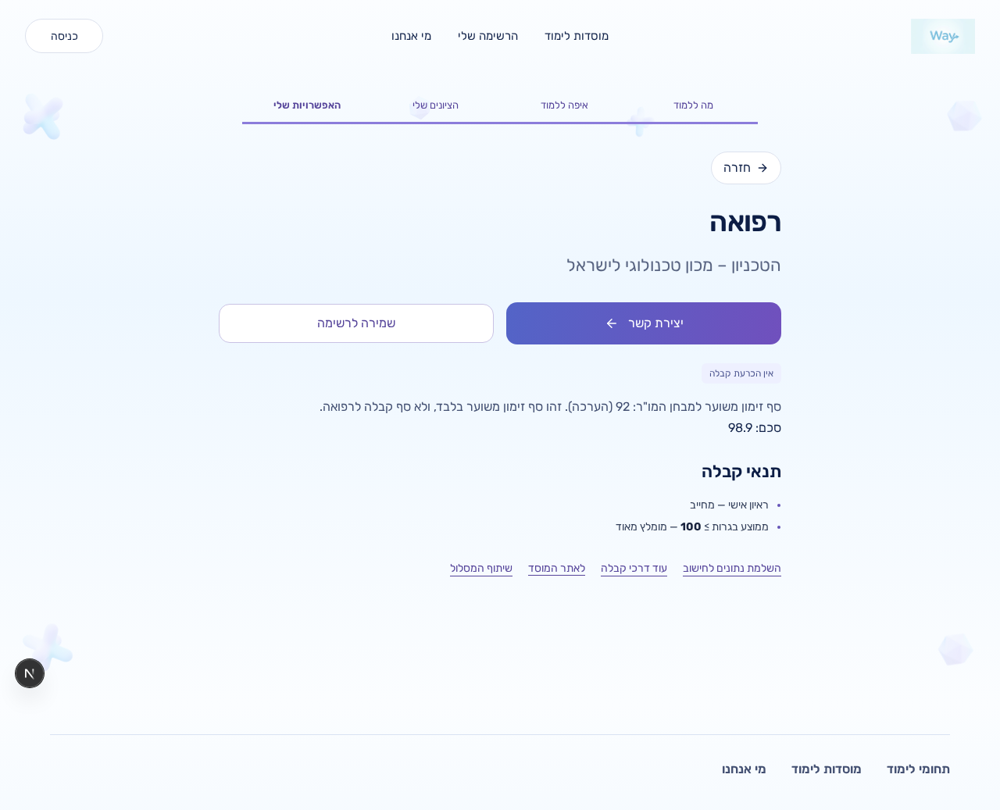
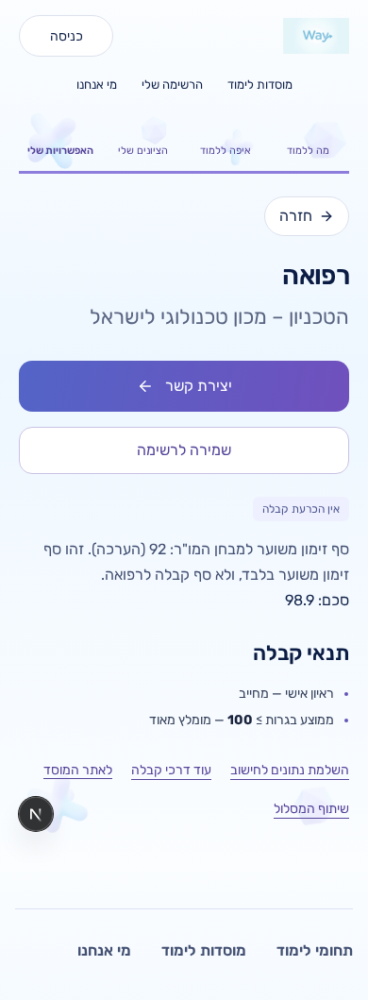

# fix(evaluator): withhold Technion medicine admission verdicts

Technion medicine returned `below` when a student's sekem was below 92. The official table identifies that number as an estimated invitation threshold for MOR screening, not an admission cutoff. `technion_medicine` now always returns `unknown`, preserves the existing sekem calculation, and uses the existing result explanation and score rendering:

> סף זימון משוער למבחן המו"ר: 92 (הערכה)

The response omits the admission threshold, score pass/fail assessment, improvement gap, and additional-condition verdict fields. It retains input requests and source failures when a score cannot be calculated. The snapshot is generated from the corrected result. No component markup, styles, formula, catalogue rows, historical captures, or verification contracts changed. The one conflicting component test was updated under Jorje's explicit ruling.

Source: [Technion official table](https://admissions.technion.ac.il/sechem-for-admission/%D7%9E%D7%A1%D7%9C%D7%95%D7%9C%D7%99-%D7%94%D7%9C%D7%99%D7%9E%D7%95%D7%93-%D7%9C%D7%A4%D7%99-%D7%90%D7%A4%D7%99%D7%A7%D7%99-%D7%94%D7%A7%D7%91%D7%9C%D7%94/), read 2026-10-25. The winter medicine row lists 92.000; its medicine footnote describes the estimated MOR invitation threshold and explains that it depends on places and applicant counts. The evaluator links to this existing official source. Existing student-facing referral rendering remains in place, including `utm_source=myway&utm_medium=referral`.

| Value | Interpretation | Change |
| --- | --- | --- |
| 92 | Estimated MOR invitation sekem | Informational text only; no admission comparison in the returned result |
| Student sekem | Existing official-calculator replay | Preserved; no new formula or formula-confidence claim |

## Approved test correction

Approved by Jorje 2026-10-25 04:21

| Test and original location | Old expected value | Approved value | Reason |
| --- | --- | --- | --- |
| `src/components/CalculatorResults.test.tsx:1040`, assertion at `:1081` — `renders manual-gate threshold failures as below the official invitation score` | Mock `decision: 'below'` at `:1054`; label `מתחת לסף`, summary `סכם 84.5 · סף 92`, and required-threshold explanation at `:1081`–`:1083` | Mock `decision: 'unknown'`, retained sekem 84.5, estimated MOR invitation line, no admission-threshold verdict or improvement gap | 92 is an estimate for screening invitations; neither side establishes admission or rejection |

The test now mocks `decision: 'unknown'`, keeps sekem 84.5, and expects the estimated MOR invitation line without an admission verdict, an admission-threshold comparison, or an improvement gap. It includes the exact source comment requested by Jorje. No other pre-existing medicine verdict expectations were changed; no existing medicine test expecting `accepted` was found.

Historical medicine verification fixtures still contain `below`/`eligible_to_apply`; they are unchanged historical artifacts, not assertions of the new public evaluator response. They must not be mistaken for a current admission verdict.

`origin/main` was merged into the task branch before applying the ruling; no rebase was used. No database write, migration application, seed application, publication workflow, environment change, production deployment, or guard bypass is part of this task. Amit visual approval remains a merge gate; opening this PR does not merge or deploy it to production.

## Verification

- Tests first: the three added evaluator cases initially failed with `below` (psychometric 720 / mocked sekem 89), `eligible_to_apply` (800 / 98.9), and `below` (500 / 73.9). All now return `unknown` with their original score and no pass/fail assessment or threshold gap.
- Focused evaluator and both result-renderer suites: **397 passed**. The new component tests verify the sekem and estimate line render without a positive/negative admission verdict. The main journey test also checks Contact, Save, and the existing official referral link.
- `npm run guard:pre-pr`: **passed after merging main and applying the ruling**, including migration consistency, catalogue seed dry-run, evidence verification, and **2,563 tests in 104 files**. No database seed was applied.
- `npm run typecheck`, targeted ESLint, Prettier, and `git diff --check`: **passed**.
- Local Chromium: **six passed checks**, using the actual evaluator's fixture-backed output for the 720/high/low profiles at **1280×900 and 390×900**. The explanation is right-aligned, no horizontal overflow occurs, and Contact/Save remain visible. Screenshots were visually inspected on desktop and mobile. Evidence from `/workspace/qa-evidence/technion-medicine-a70b3be/` is committed under `docs/admissions-verification/evidence/technion-medicine/`.
- Browser evidence uses explicit local static catalogue mode and mocks official score/table responses and the browser evaluation endpoint. It verifies rendering, not authenticated preview/production access or a new live official-calculator comparison. No deployed behavior is claimed.
- CI and the Vercel preview deployment are checked against the PR head; results and the preview URL are recorded on the PR. Production behavior is not claimed.

## Screenshot evidence

Captured from implementation commit `a70b3be`, before the subsequent merge from main and test-only ruling update. Official responses and the evaluation endpoint are mocked as described above.

| Profile | Desktop 1280px | Mobile 390px |
| --- | --- | --- |
| Psychometric 720, sekem 89 |  |  |
| High sekem 98.9 |  |  |
| Low sekem 73.9 |  |  |

Code review: skipped (ce-code-review unavailable) — Encoded profile restriction.
