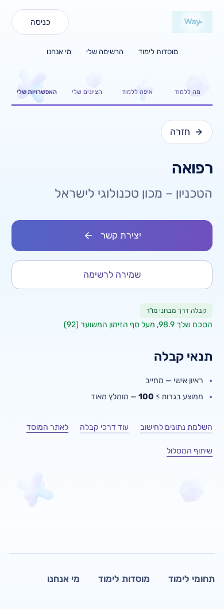
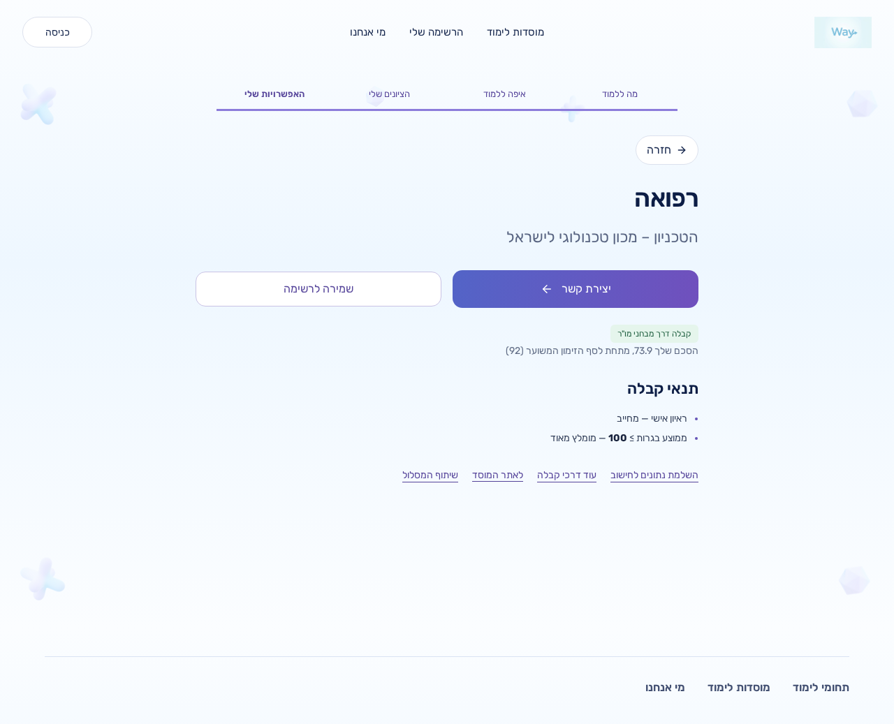
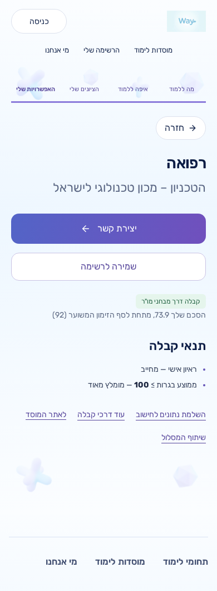
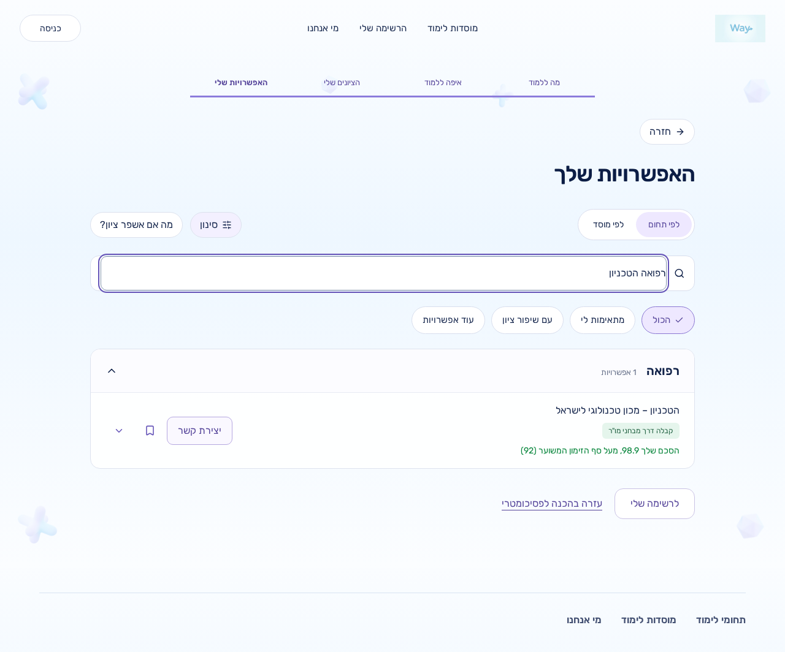
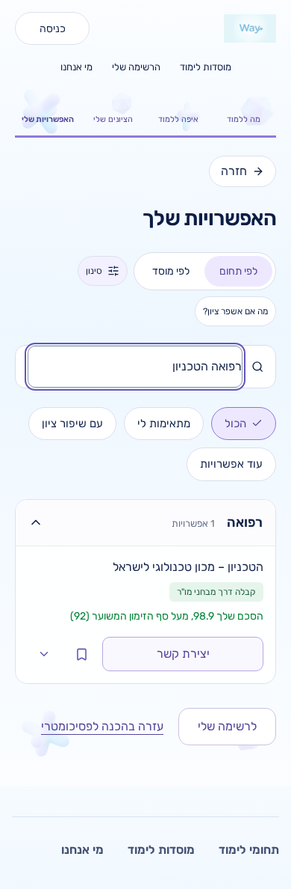
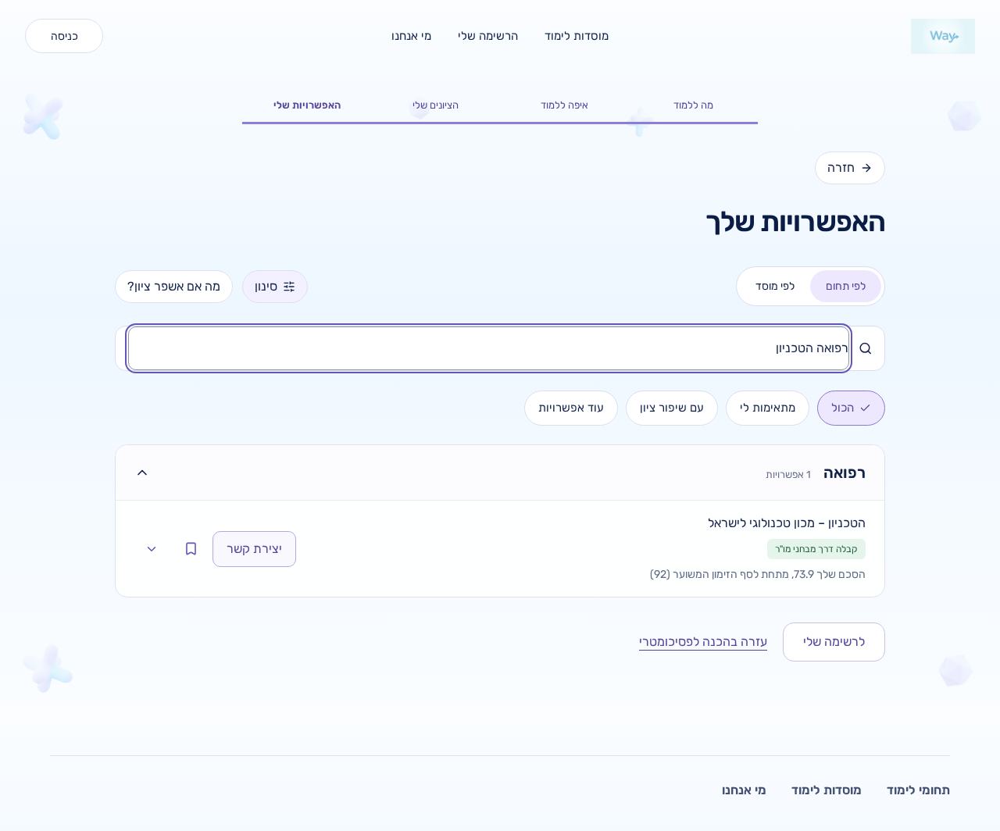
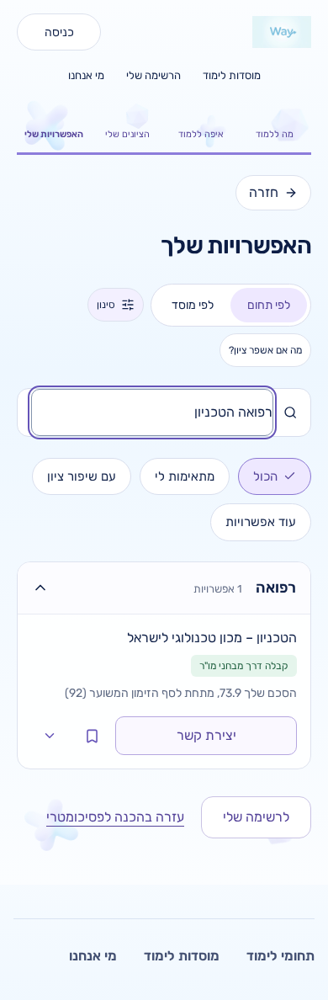

# Technion medicine: MOR screening and estimated invitation comparison

`technion_medicine` at `technion` retains its calculated sekem without an admission verdict. The 92 is an estimated MOR invitation threshold, not an admission threshold.

## Samuel QA A1 fix — list card comparison line

Samuel's QA found that `rowView` displayed the medicine chip without the comparison paragraph. The results-list card now renders the existing `TechnionMedicineComparison` immediately after the chip, just as the detail view does. No new comparison, threshold helper, copy, style or API field was added.

The chip stays green for **both** above and below profiles, exactly as approved in the 08:01 ruling. Comparison text remains green at/above 92 and muted below. The semantic group stays `explore` and the API stays `unknown`, with no threshold/assessment/gap.

Tests first: the final three list cases (98.9, 92, 73.9) were run with only `StudyJourney.tsx` temporarily copied from `4e3e718`. All three failed specifically because the comparison line was missing. The pending component was restored, and all cases passed. Each checks exactly one paragraph, its text/classes, immediate sibling placement below the green chip, and matching detail text/classes after opening the card. The exact-92 case therefore explicitly covers both surfaces with `מעל` and `text-green-700`. Existing medicine chip tests and the Haifa regression are unchanged from `4e3e718`.

Test comment: `// Samuel QA A1 2026-10-25`.

## Amit ruling 2026-10-25 08:01 via Jorje

The scored medicine status `קבלה דרך מבחני מו"ר` uses the existing success chip styling for both above and below profiles. The approved comparison lines are unchanged.

- Journey list and detail chips reuse exactly `journey-status status-match`, the existing accepted/meets-cutoff badge classes. A narrow class override applies only to scored `technion_medicine` at `technion`, and does not mask a failed-result status.
- `CalculatorResults` uses `STATUS_CONFIG.exactAccepted.bg` for this medicine chip, preserving the other shared badge classes and label.
- This is a CSS-only override. `resultLabel(...).group` remains `explore`; medicine is not counted, filtered or sorted as an accepted match. The API remains unchanged (`unknown`, no threshold/scoreAssessment/deltaNeeded).
- Other programmes keep their existing classes. A Haifa pending regression checks `journey-status status-explore` in list and detail views.
- Tests first: the seven existing medicine parameter cases failed on the new success-chip assertions before implementation; the Haifa regression passed. All now pass. Test comments record `// Amit ruling 2026-10-25 08:01 via Jorje`.

## Amit ruling 2026-10-25 07:30 via Jorje

The owner explicitly approved this visual change; no further mockup round is needed.

- Status with a score: `קבלה דרך מבחני מו"ר`.
- X >= 92: `הסכם שלך X, מעל סף הזימון המשוער (92)` in existing `text-green-700`, already used for accepted scores in `UniversityCard.tsx`.
- X < 92: `הסכם שלך X, מתחת לסף הזימון המשוער (92)` in existing `text-slate-500`, mapped to `--text-muted`. No red/danger/warning styling.
- Journey list/detail and the legacy result card use one shared comparison paragraph. The old estimate explanation and separate score row are hidden only for scored medicine results. The legacy card also hides its redundant source label and next-action explanation. Contact, Save and existing official referral links remain available.
- No-score behaviour is preserved: existing input requests, status and explanation remain; no score is invented.

**Semantics:** inclusive `>=`. Exactly 92 uses the approved above-threshold wording and green style. This matches the existing inclusive comparison in `normalizeExactProofResult` and the Technion adapter. It is a UI comparison, never an admission verdict.

**Source of 92:** the existing `verifiedProgramThresholds` entry for `technion_medicine` in `src/data/admissions/mondayEvidence.generated.ts`. The exported `TECHNION_MEDICINE_INVITATION_THRESHOLD` in `src/data/admissions/technionThresholds.ts` reads that field, without introducing a new numeric value. UI and evaluator both use it. Evidence, thresholds, verification dates, formulas and contracts are unchanged.

**Formatting:** `formatJourneyScore` extracts the existing journey expression `score.toLocaleString('he-IL', { maximumFractionDigits: 2 })`. The ordinary score row and medicine comparison reuse it without a new rounding policy.

**Other programmes:** `אין הכרעת קבלה` is shared by exact/estimated results without a positive/negative verdict. Haifa's evaluator can return `kind: 'exact', decision: 'pending'`, including sociology and physiotherapy waiting ranges. That generic label remains. The new label requires programme `technion_medicine`, institution `technion`, an existing score and decision `unknown`. Journey list/detail status calls carry the programme ID; the result stays in the `explore` group.

**API unchanged:** `decision: 'unknown'`; `threshold`, `scoreAssessment` and `deltaNeeded` remain undefined. No verdict field was added. The API explanation text is unchanged; its literal 92 is now interpolated from existing evidence. It remains available for no-score rendering and is hidden by the scored-medicine UI. Calculation, snapshots, IDs and official links are retained, including `utm_source=myway&utm_medium=referral`.

Source: [Technion official table](https://admissions.technion.ac.il/sechem-for-admission/%D7%9E%D7%A1%D7%9C%D7%95%D7%9C%D7%99-%D7%94%D7%9C%D7%99%D7%9E%D7%95%D7%93-%D7%9C%D7%A4%D7%99-%D7%90%D7%A4%D7%99%D7%A7%D7%99-%D7%94%D7%A7%D7%91%D7%9C%D7%94/), inspected during the original fix on 2026-10-25. Its medicine footnote describes the estimated MOR invitation threshold and its dependence on places and applicant counts. This follow-up makes no new live-calculator or production-verification claim.

## Earlier test approval

Approved by Jorje 2026-10-25 04:21

The former `CalculatorResults.test.tsx:1040` test mocked `below`, sekem 84.5, admission threshold 92 and an improvement gap. Jorje approved `unknown` with sekem 84.5 and no threshold/gap. Amit's later ruling updates only its medicine presentation assertions to the new status and comparison. Both approval comments remain. Historical verification fixtures are unchanged.

## Tests first and checks

Seven new above/below/boundary rendering cases failed against the old UI, then passed after implementation. Existing presentation assertions changed only where this ruling applies, with `// Amit ruling 2026-10-25 07:30 via Jorje`.

Test names:

- `shows one comparison directly under the medicine list chip for sekem %s`: 98.9, 92, 73.9; one immediate comparison, exact approved text/classes, green chip in all cases, and matching list/detail rendering including the boundary.

- `renders one medicine comparison for sekem %s without an admission verdict`: 95, 84.5, 92; exact copy, success/muted classes, no red/warning, one comparison, no old status/explanation, official referral link retained.
- `shows one medicine comparison for sekem %s`: 95, 84.5, 92, 95.125; also verifies existing decimal formatting and Contact/Save.
- The two parameterized component tests above now additionally check the existing green chip classes, absence of purple/violet styling, and unchanged comparison text. Journey cases verify both list and detail chips and assert that the result group remains `explore`.
- `keeps Haifa pending chip in its existing no-verdict style`: preserves `journey-status status-explore` in list and detail views.
- `preserves the medicine result explanation when no sekem is available`: existing input request and explanation.
- `preserves other programmes no-verdict status for kind %s`: exact/estimated foreign programme and institution pairs remain generic.
- `renders the estimated medicine MOR invitation threshold without an admission verdict or improvement gap`: approved legacy regression keeps its no-verdict/no-gap assertions with new copy.
- `keeps sekem $score without a verdict for psychometric $psychometric`: API scores 89, 98.9, 92, 73.9 retain `unknown`, no threshold/assessment/gap and the existing source link.

Results:

- Changed component suites: **49 passed**.
- Full unit suite: **3,545 passed, 86 skipped**. Database integration tests were not enabled.
- Full lint, typecheck, changed-file format check, optimized production build, `git diff --check`: **passed**. The standalone typecheck was rerun successfully after the build because the initial overlapping run saw Next delete generated `.next/types` files.
- `npm run guard:pre-pr`: **passed, 2,639 tests in 106 files**, plus migration consistency, seed dry-run and evidence checks. No migration/seed was applied.
- Design detector: no findings.

`origin/main` at `5ca84ce` was merged, never rebased. No other worktree was modified. No live database/Supabase access, production deployment, environment/secret change, GitHub comment, force-push, hook bypass or draft-state change is part of this task. Final CI results for the pushed head are recorded on the PR. CI jobs will not be rerun; any failure will be reported with its log excerpt, with fixes only for failures caused by this change.

## Screenshot evidence

List-fix code commit: `13dcd152bc7907425c2c78ff54a5d80798f79799`. The subsequent docs/evidence commit changes no application code. Existing detail captures from code commit `281012e` (present at `4e3e718`) are retained byte-for-byte. Screenshots use its optimized local production build, explicit static catalogue mode and `npm run start -- --port 3285`.

The browser uses the existing `/app/calculator#detail` route with synthetic ordinary Bagrut records and psychometric 800/500. Same-origin `/api/admissions/evaluate` POSTs run through the real built route and evaluator; they are **not intercepted or mocked in the browser**. Runtime-only in-memory freshness and official calculator/table fixtures supply scores 98.9/73.9 without any database connection or external calculator POST. Service workers are blocked; other browser non-GET requests are intercepted with synthetic HTTP 200. No lead is submitted.

The four new list captures follow the real detail → back-to-results flow and use the existing search filter (`רפואה הטכניון`) to isolate the card. All four checks verify the actual local HTTP response retains `unknown` with no threshold/scoreAssessment/deltaNeeded, exact copy, one comparison only, new status, right alignment, Contact/Save visibility and no overflow. The chip has `journey-status status-match` with computed background `rgb(229, 245, 236)` and text `rgb(33, 97, 65)` in both profiles. The comparison remains green above and `rgb(94, 106, 131)` (the muted token) below. All four new list images were visually inspected. The comparison is the chip's immediate next sibling and appears below it at both widths; the same text and computed class/color appear in detail and list.

New list source: `/workspace/qa-evidence/technion-medicine-13dcd15/`. The original detail source remains `/workspace/qa-evidence/technion-medicine-281012e/`; the four committed detail images are unchanged.

| Profile | Desktop 1280px | Mobile 390px |
| --- | --- | --- |
| Above, sekem 98.9 |  |  |
| Below, sekem 73.9 |  |  |

List-card evidence:

| Profile | Desktop 1280px | Mobile 390px |
| --- | --- | --- |
| Above, sekem 98.9 |  |  |
| Below, sekem 73.9 |  |  |

Code review: skipped (ce-code-review unavailable) — Encoded profile restriction.
