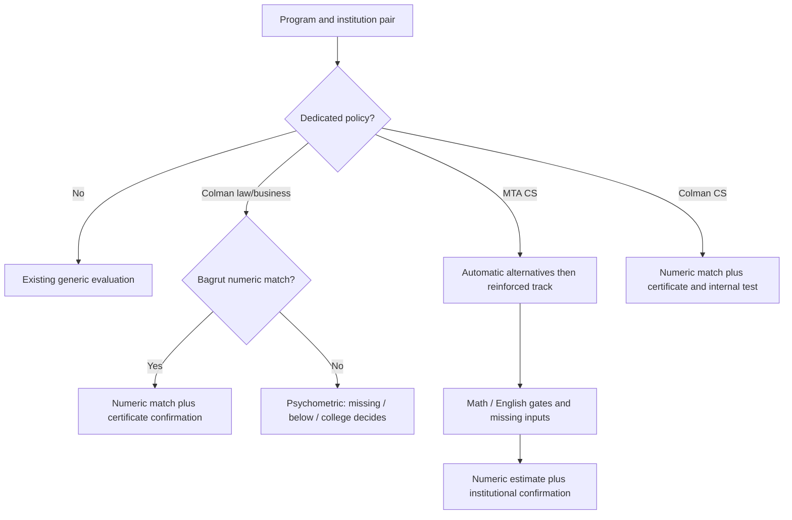

## Goal Capsule

Replace placeholder admission information and unconditional eligibility for MTA CS and Colman law, business and CS with the supplied official requirements. Preserve program IDs, profile scores and the approved Hebrew UI. The task brief and canonical official-values fixture govern exact copy and route behavior.

## Product Contract

### Problem Frame

Institution-level evidence currently permits eligibility at any score for three programs; Colman CS also permits eligibility despite its mandatory internal test. Students need route-specific numeric matches, separate confirmations and a useful next action.

### Requirements

R1. Preserve canonical IDs and seed copy byte for byte from the operator fixture, with official program/calculator links, notes and English minimum.
R2. Evaluate Colman law/business Bagrut thresholds using only the Colman average. Keep certificate confirmation separate. The psychometric route is always unknown when published minima are met because the institutional weighted cutoff is unpublished.
R3. Evaluate all MTA automatic and reinforced alternatives, rounded combined score and its valid domain, math and English gates, and missing inputs. Clearly identify estimated scores and reinforced-track results; require institutional confirmation of eligibility/average and never invent an interview.
R4. Colman CS stays manual_gate, displays numeric matches separately, and never returns eligible_to_apply because its internal test is outstanding.
R5. Preserve compact RTL public pages and official referral attribution; verify seed and DB serialization, route boundaries and desktop/mobile behavior.

## Planning Contract

KTD1 (session-settled: user-directed). Route only the four specific program/institution pairs to program policies before generic Monday evidence. Other programs retain their behavior.
KTD2 (session-settled: user-directed). Use existing decision kinds and withScoreAssessment. Keep Colman CS's test as an outstanding additional condition rather than exposing eligible_to_apply.
KTD3 (session-settled: user-directed). No DB changes, SQL, migrations, seeds, freshness/publication workflows, settings changes, comments or outreach. The required guard's seed dry-run is local validation only. Amit applies the production text separately after deployment.
KTD4. Allow Bagrut-only routes through existing calculator input validation. Reuse stored subject math over loose fields and existing English input. MTA average remains an estimate; general eligibility is an unconfirmed institutional condition.

### High-Level Technical Design

## Implementation Units

### U1. Official catalogue content

Requirements: R1, R5. Files: src/data/degrees/academicPrograms.ts, src/data/degrees/index.ts, docs/admissions-verification/2026-10-22-official-requirements-4.json and relevant catalogue tests. Copy canonical values, preserve IDs/profileScore, align URL override, and assert seed plus serialized DB-row fidelity. Capture supplied source quotes and uncertainty in verification documentation. Test exact text and URLs for all four programs.

### U2. Admission policies and route wiring

Requirements: R2, R3, R4; KTD1–KTD4. Files: src/server/admissions/*Evaluation.ts and tests, evaluator.ts and tests, src/types/admissionsEvaluation.ts, src/lib/calculatorInputRequirements.ts and tests, scripts/pre-pr-guard.mjs. Add focused law/business and MTA policies; retain CS policy with an outstanding internal-test condition. Test inclusive and just-below boundaries, rounding and valid formula domain, each automatic/reinforced alternative, missing math/English/quantitative/Colman-average inputs, route precedence, separate certificate confirmation and absence of MTA interview. First strengthen the existing CS eligibility assertion to demonstrate the regression.

### U3. Public display and verification

Requirements: R5. Dependencies: U1, U2. Files: src/lib/publicCataloguePages.ts, shared admission presentation and tests as needed, e2e coverage and design-qa.md. Display official notes/calculator links compactly using existing components. Check all four pages at desktop/mobile widths and calculator results, including empty and filled inputs. Use explicit local/static mode for seed previews; never substitute static content on DB failure. Run targeted Vitest, typecheck and required guard; simplify before one feature-branch PR.

## Verification Contract

Boundary and integration tests must cover the outcomes in the task brief, not mock the policies. Assert exact canonical JSON strings and source_urls program/calculator serialization. Verify all four program pages in Chromium at 390px and desktop, plus narrow-width overflow and RTL. The required pre-PR guard performs migration consistency, grants, seed dry-run and regression tests without database writes. Record direct browser evidence and deployed-state limitations separately.

## Definition of Done

All requested route outcomes and canonical copy pass relevant tests and typecheck; pre-push guard passes; pages remain compact and RTL. One feature-branch PR contains official URLs/quotes, route behavior table, internal-test decision, separate production-text rollout and unverified MTA averaging-change note. No SQL, migration edits or live-data mutations.
