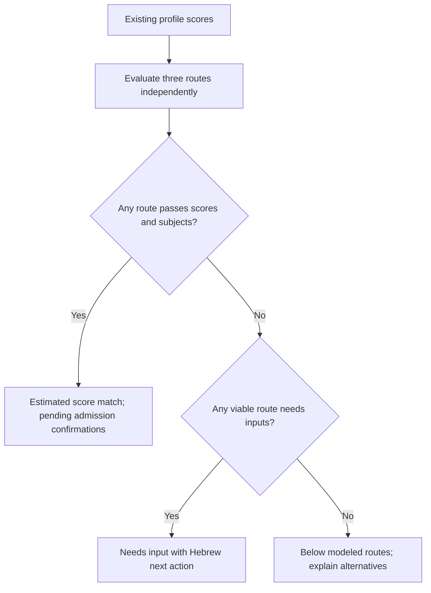

## Summary

Calculate the published תשפ״ז CS, law and standalone psychology routes from the student's existing scores. Keep the reverse-engineered formula estimated and distinguish score eligibility from admission confirmations.

## Problem Frame

Reichman currently returns requirements-only results. The existing coordinated formula has no reviewed route thresholds attached, so students cannot get a calculated answer.

## Requirements

R1. Evaluate coordinated, Bagrut and psychometric routes for the three requested IDs without a precomputed coordinated input.
R2. Use verified numeric and subject gates; missing subject inputs must never count as passing.
R3. Preserve unrelated institutions, IDs, formulas, UI and production database state.
R4. Cover weak/strong profiles, formula fixtures, boundaries, independent routes and API dispatch; pass the pre-PR guard and open one PR.

## Key Technical Decisions

KTD1. Follow the Colman dispatch pattern with a dedicated evaluator and a shared Reichman formula helper in `src/utils/sekhemCalculators.ts` (session-settled: user-directed — chosen over generic requirements handling to produce a calculated answer).
KTD2. Use the supplied official PDF extract as threshold evidence because the recorded live PDF cannot currently be fetched. CS: 705/108/720, coordinated psychometric minimum 660; law: 650/100/700, coordinated minimum 610; psychology: 620/100/640 with math 3+ units at 85 and English 4+ units at 90. CS math: 5 units at 85 for coordinated/Bagrut, 80 for psychometric; Bagrut also requires a qualifying 5-unit science at 85.
KTD3. Select a route with passing scores and subject gates before routes needing input; return below only if no modeled route remains viable. Positive numeric results carry estimated confidence and pending confirmation of full Bagrut eligibility and applicable language requirements. Preparatory and special admissions paths are outside the numeric decision.

## High-Level Technical Design

## Implementation Units

### U1. Published route decisions

**Goal:** Deliver R1–R3 using KTD1–KTD3.
**Files:** `src/utils/sekhemCalculators.ts`, `src/server/admissions/reichmanPublishedRoutesEvaluation.ts`, `src/server/admissions/reichmanPublishedRoutesEvaluation.test.ts`, `src/server/admissions/evaluator.ts`, `src/server/admissions/evaluator.test.ts`, `src/types/admissionsEvaluation.ts`.
**Approach:** Share the existing formula, read subject records with the existing exam-only helper, and keep each route's missing and failing inputs separate. Reuse the result contract for score assessments and additional conditions without changing other evaluators.
**Patterns:** `src/server/admissions/colmanPublishedRoutesEvaluation.ts` and `src/server/admissions/colmanBagrutEvaluation.ts`.
**Test scenarios:**

- All three programs at 420/70 return below, including missing subject inputs.
- Each published route can match without a coordinated input; outstanding confirmations remain pending.
- Coordinated minimum psychometric gates and score/subject boundaries are enforced.
- Missing math, English or science inputs request existing profile fields; exam records take precedence over legacy fields.
- Formula fixtures return independently calculated values and the legacy dispatcher retains the same result.
- Evaluator and API dispatch use these decisions; existing Colman, Ono and Haifa coverage passes.

### U2. Source and catalogue alignment

**Goal:** Remove contradictory local Reichman copy where official evidence supports it (R2–R3).
**Dependencies:** U1.
**Files:** `src/data/degrees/academicPrograms.ts`, `docs/admissions-verification/2026-10-23-reichman-published-routes.md`, `scripts/pre-pr-guard.mjs`.
**Approach:** Record exact source rows and limitations; align local notes and official program links if unambiguous. Add the new evaluator suite to the existing guard. Never execute seeds or publication.
**Test expectation:** Existing catalogue seed dry-run and guard checks validate local data; no production write.

## Verification Contract

Run targeted evaluator/formula/API tests, typecheck and changed-file lint, then `npm run guard:pre-pr`. Exercise the API with real evaluator dispatch and, when available, a local or preview browser at desktop/mobile. Report actual deployed evidence and any access limitation. Do not trigger a deployment manually or write to the shared production DB.

## Scope Boundaries

No UI tiles, analytics, other institutions, migrations, seeds against a database, publication/freshness workflows or external configuration changes. No review pipelines, as explicitly instructed. Business/economics/information-systems and preparatory/special routes remain follow-up work.

## Definition of Done

The three programs have tested calculated decisions, weak profiles cannot pass, numeric matches expose remaining confirmations, the guard passes, and the authorized feature branch is committed and pushed with a PR against main.

## Sources and Limitations

- Official thresholds PDF: https://www.runi.ac.il/media/4tsb3m1v/ספי-קבלה-לתואר-ראשון-תשפז.pdf — supplied text extract checked by column; live URL unavailable during verification.
- Official calculator: https://www.runi.ac.il/admissions/undergraduate/calculator — describes averages as indicative and reserves the institution's final calculation.
- Existing source registry: `src/server/ingestion/admissionsSourceRegistry.ts`, `reichman-client-formula` remains partial evidence.
