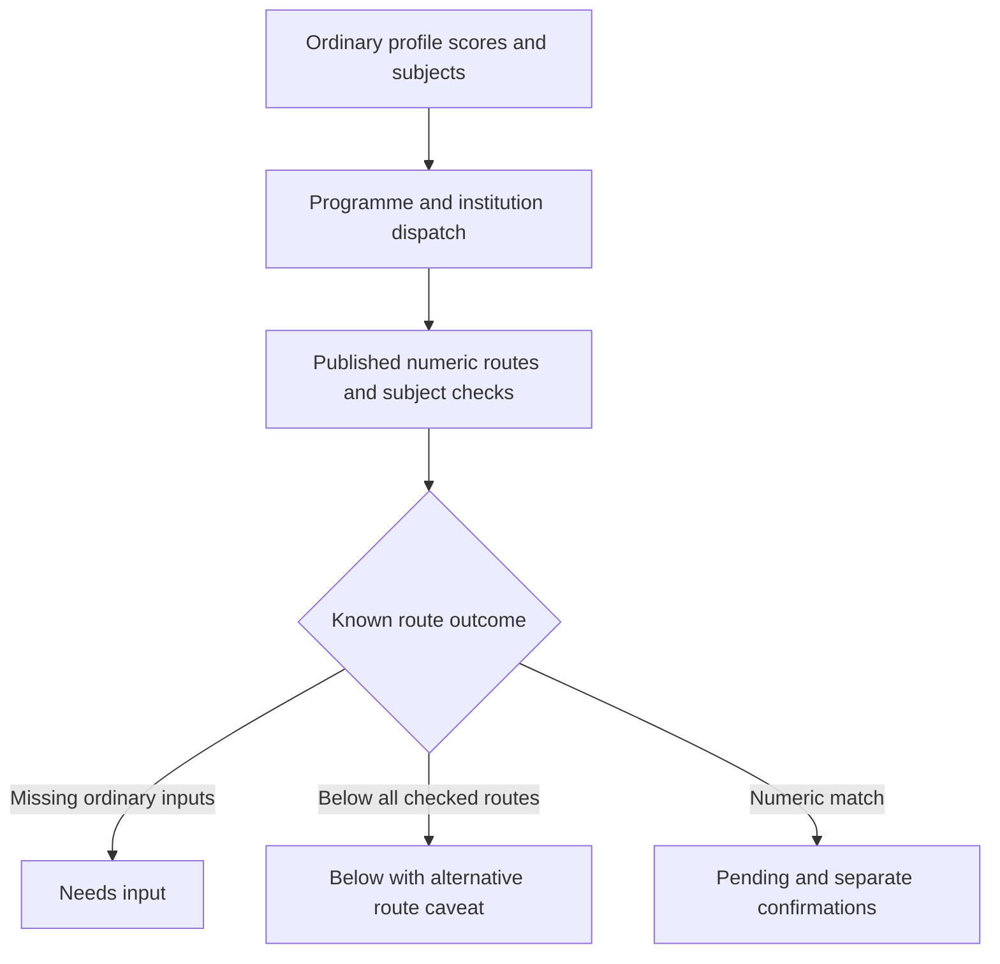

## Goal Capsule

Increase trustworthy score coverage using the supplied official extracts, preserving existing programme IDs and scoring formulas. Deliver one PR against main on `codex/telhai-cs`. Jorje verifies readiness; Amit controls merge and publication. Database writes, publication jobs, deployments, environment changes, outreach and review pipelines are outside authorization.

## Product Contract

### Requirements

- R1. Encode Tel Hai CS and biology, Ono CS and business, and Ruppin CS from the official source packet. Numeric matches remain pending with separate confirmations; weak 420/70 profiles return below for the encoded routes.
- R2. Extend existing Reichman routes for business and economics after reading the actual PDF row, keeping coordinated-score computation automatic. Subject gates and preparation conditions remain visible and independently pending.
- R3. Wire MTA/Colman aliases only if distinct catalogue IDs exist. Encode optional Colman programmes only with explicit official thresholds; TAU medicine remains requirements-style pending if its formula is absent.
- R4. Missing subjects request ordinary subject inputs. Never request an institutional composite, invent grades or equate a numeric match with final admission.
- R5. Replace stale seed requirements for encoded IDs and document every encoded/deferred candidate, confidence, formula gap and source limitation. Preserve unrelated routes and all IDs.

### Scope Boundaries

BIU composites, engineering-college mapping, Ariel, generic slugs, phantom programmes, nursing/social work and audition programmes are deferred as directed. Dual degrees and specialized Reichman tracks are not silently mapped to standalone programmes.

## Planning Contract

- KTD1. Extend institution-specific evaluators and dispatch before generic requirements processing, using existing result types. Reuse `calculateReichmanCoordinatedScore`; no new composite formula.
- KTD2. Structured ordinary exam rows override legacy subject fields, including complete records and final-project exclusions.
- KTD3. For partially covered Ruppin and Tel Hai biology, below means below the encoded numeric routes; copy and documentation preserve uncomputed alternatives.
- KTD4. Follow the user-directed plan → work → simplify sequence; no code-review or document-review pipeline.

### High-Level Technical Design

The intended flow follows the current evaluator architecture:

The PDF economics row is authoritative over the brief's approximate gate: math 4 units at 75 or 5 at 60, with prep confirmation below 4 at 85 or 5 at 65; psychometric route additionally requires quantitative 125. Business includes a 95–99 Bagrut alternative with additional subject gates. These execution details require focused boundary tests.

## Implementation Units

### U1. Plain numeric evaluators

Implement institution modules for R1/R4, their dispatch and seed requirements. Test weak profiles, inclusive full/committee thresholds, missing scores and subjects, 3-unit biology preparation, science alternatives and structured-record precedence.

### U2. Reichman extension and conditional candidates

Implement R2/R3 using existing evaluator patterns. Test automatic coordinated scores, each standalone boundary, language/math/quantitative gates, preparation confirmations and no regressions in CS/law/psychology, MTA and Colman. Document unclear mappings rather than inventing them.

### U3. Evidence and verification

Fulfil R5 with the requested verification table and Jorje report. Check dispatch through local evaluate tests, student-visible results in desktop/mobile browser if available, focused and regression suites, typecheck/lint and `npm run guard:pre-pr`. No check may write to the production database.

## Verification Contract

Run focused Vitest tests for new modules plus evaluator integration and existing Reichman/MTA/Colman suites. Run typecheck, lint and the pre-PR guard after checking its operations are read-only/dry-run. Use existing Playwright infrastructure for the calculator, with a desktop screenshot and mobile check where available. Inspect PR CI at the pushed tip; report unavailable deployment/browser checks accurately.

## Definition of Done

All supported candidates have tests and updated seed copy; unsupported candidates have explicit reasons. Numeric score assessment and confirmations remain separate. One conventional commit/PR is open, no merge or DB publication occurs, and evidence is available for Jorje without claiming readiness on his behalf.
