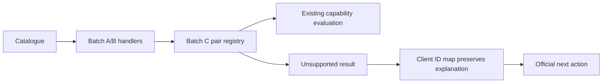

# Honest unsupported admissions UX (Batch C)

## Goal Capsule

**Objective:** Students understand when MyWay cannot assess admission and can continue to the institution’s official site.
**Means:** Explicit programme/pair dispatch and client explanation preservation (KTD1).
**Authority:** The Batch C operator brief and MyWay standing rules govern scope; Jorje verifies admissions accuracy before any merge decision. This run implements, verifies, commits, pushes the named branch, and opens one PR. Stop with evidence if required checks or publication cannot complete. No merge or production writes are authorized.

---

## Product Contract

### Summary

Replace vague results for the remaining unsupported, course-based, and ambiguous catalogue mappings with concise Hebrew explanations and an official next action.

### Problem Frame

Some catalogue entries remain unknown regardless of ordinary grades. Generic UI copy conceals why no reliable assessment exists; Ariel’s coverage note also implies scoring that this batch must explicitly avoid.

### Requirements

- **R1:** Recompute the gap from main at `605b0d3` using the current catalogue, evaluator, and A/B handlers before changing production code. Record every candidate and disposition in `docs/admissions-verification/2026-10-23-batch-c-unsupported.md`.
- **R2:** Include every catalogue `ariel_*` ID; return unsupported capability/kind and unknown decision with a clear Hebrew explanation and official next action for every Batch C pair, with empty, weak, and strong inputs alike.
- **R3:** Never invent formulas, thresholds, score matches, or institutional composite input fields. Keep Batch A numeric behavior, Batch B manual behavior, open admission, exact and estimated supported paths intact. BIU remains a composite follow-up.
- **R4:** Preserve evaluator explanations in the client using a client-safe programme/institution map. Keep contact/save prominent, concise Hebrew right-aligned, and official links attributable through existing referral handling.
- **R5:** Leave clearly encodeable rows with existing official extracts unchanged and list them as follow-up encode candidates. Do not delist ambiguous rows or assert new admission requirements.
- **R6:** Deliver registry unit tests, API tests, `e2e/batch-c-admissions.spec.ts`, successful required local checks and Prettier validation, a conventional commit, and one PR against main.
- **R7:** Do not change database state, migrations, seeds, freshness jobs, environment/secrets, external settings, or publish comments/outreach. Do not run code-review or multi-agent review pipelines.

### Scope Boundaries

Numeric Ariel/BIU encoding, delisting, redesign, and production release remain follow-up work. No new API schema, fallback catalogue, or generic registry framework is needed: existing evaluator/result contracts already express unsupported outcomes.

### Acceptance Examples

- **AE1 (R2):** Ariel CS with no scores or with 120/800 returns unknown/unsupported without requesting extra inputs or claiming score eligibility.
- **AE2 (R3):** Existing Batch A boundaries and Batch B manual outcomes pass unchanged.
- **AE3 (R4):** A selected Batch C result on desktop/mobile shows the evaluator’s specific explanation and official action; contact/save remain usable.

---

## Planning Contract

### Key Technical Decisions

- **KTD1:** Mirror the Batch B server registry/client-safe ID map pattern. Key matching includes institution identity so generic programmes cannot override supported peers (R2–R4).
- **KTD2:** Place Batch C dispatch after existing A/B handlers and before generic capability dispatch. Preserve unsupported results through any result decoration; test actual evaluator/API output (R2–R3).
- **KTD3:** Derive the exact non-Ariel membership during U1 from current evaluation results, not the stale coverage snapshot. No official extracts for new numerical encodes are introduced (R1, R5).

### High-Level Technical Design

### Assumptions

The checked-out catalogue is the reproducible inventory for this code change. Deployed catalogue parity is checked through preview when available, without production database access. Local browser runs use the explicit static catalogue mode. Browser/CI availability is an execution-time concern and must be reported honestly.

### Sources

The operator Batch C brief is the product source. Relevant patterns: `src/server/admissions/batchBManualPathEvaluation.ts`, `src/data/admissions/batchBManualProgramIds.ts`, `src/lib/studyJourney.ts`, and `e2e/batch-b-admissions.spec.ts`. `CONCEPTS.md` supplies domain vocabulary. The existing official extract packet contains A/B source material; it is inspected when classifying follow-ups. Next.js route guidance is available in the installed package docs.

---

## Implementation Units

### U1. Recompute and document the current gap

**Goal:** Establish justified membership before code changes.
**Requirements:** R1, R3, R5. **Dependencies:** None.
**Files:** `docs/admissions-verification/2026-10-23-batch-c-unsupported.md`.
**Approach:** Enumerate all catalogue pairs; compare empty, weak and strong evaluations with network disabled and explicit freshness state. Subtract A/B and supported paths. Inspect unclear rows and existing source extracts, and record candidate dispositions, all 19 observed Ariel IDs, official URL provenance, and remaining encode follow-ups.
**Test expectation:** No persistent test for documentation; retain reproducible method and baseline counts.
**Verification:** Every catalogue Ariel ID appears; each selected pair has a reason; no supported peer is swept into the registry.

### U2. Dispatch honest unsupported results and preserve copy

**Goal:** Deliver the specific unsupported explanation through evaluator and client.
**Requirements:** R2–R4, AE1. **Dependencies:** U1.
**Files:** `src/server/admissions/batchCUnsupportedPathEvaluation.ts`, `src/data/admissions/batchCUnsupportedProgramIds.ts`, `src/server/admissions/evaluator.ts`, `src/server/admissions/calculatorCoverage.ts`, `src/server/admissions/batchCUnsupportedPathEvaluation.test.ts`, `src/lib/studyJourney.ts`, `src/lib/studyJourney.test.ts`.
**Approach:** Apply KTD1/KTD2 with reason-specific copy and existing official URLs. Correct Ariel coverage action. Avoid broader UI or result-contract changes.
**Test scenarios:**

- Every registry pair returns unknown/unsupported for empty, weak and strong profiles, without scores or required composite inputs.
- Wrong-institution lookup does not match; client/server maps agree; A/B and C IDs do not collide.
- All catalogue Ariel programmes are covered and client explanations retain their text.
  **Verification:** Focused tests and existing A/B regression tests pass.

### U3. Verify API and student flow, then deliver

**Goal:** Prove the externally used behavior and produce one reviewable PR.
**Requirements:** R3, R4, R6, R7, AE2, AE3. **Dependencies:** U2.
**Files:** `src/app/api/admissions/evaluate/batchC.test.ts`, `e2e/batch-c-admissions.spec.ts`, `scripts/pre-pr-guard.mjs`, verification doc from U1.
**Approach:** Exercise the real POST handler for all selected pairs, including batch requests. Add representative Ariel and other Batch C browser smoke at desktop/mobile widths. Extend existing targeted guard tests for Batch C. Run mandatory simplification inline; record the operator-authorized review skip exactly. Commit/push/open one PR using existing GitHub workflow.
**Test scenarios:**

- API empty/weak/strong requests never return eligibility for Batch C.
- Batched results preserve supported A/B outcomes alongside C.
- Browser renders the specific Hebrew explanation and official action, with contact/save and no composite fields or horizontal overflow.
  **Verification:** Required checks and browser results are recorded with concrete evidence; any preview or CI blocker is identified.

---

## Verification Contract

Run focused unit/API/client tests, A/B regressions, typecheck, lint, changed-file Prettier checks, and the existing pre-PR guard without bypass. Run Batch C Playwright against local static mode, then preview when available using existing workflows. No database writes or migrations are part of verification. Simplify the substantive diff with `ce-simplify-code mode:pipeline` before opening the PR. Record exactly: `Code review: skipped (ce-code-review unavailable)`; reason: MyWay standing rules and this brief forbid ce-code-review, and Jorje verifies admissions accuracy offline.

## Definition of Done

U1’s full membership and follow-ups are documented; U2’s dispatch and UI copy preserve R2–R4; U3’s required checks pass and one PR is open with head SHA and evidence. Remove abandoned experimental code and leave no unrelated changes. Do not claim merge-ready or admissions accuracy sign-off; that decision belongs to Jorje/Amit.
