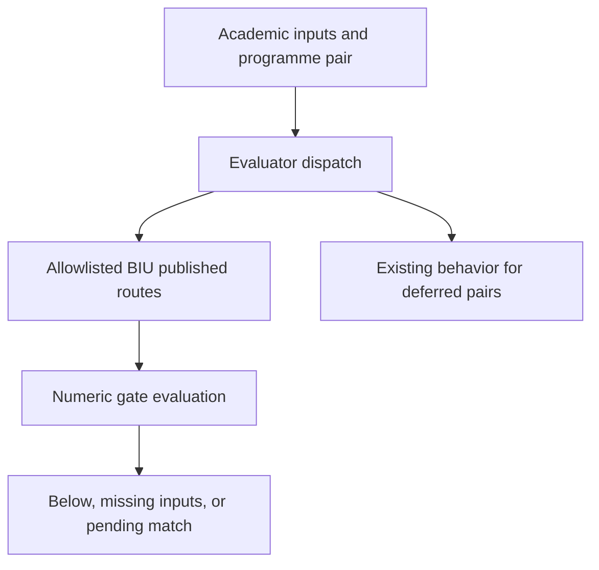

# BIU admissions encode - Plan

## Goal Capsule

Help prospective students check BIU admission routes from ordinary academic inputs without supplying an institutional composite.
Encode only routes supported by official BIU evidence, preserve honest pending results, and deliver one PR against main.
Jorje verifies admissions accuracy before any merge.
Stop without a code PR if no route can be encoded without invention.

## Product Contract

### Problem Frame

BIU programmes currently lack usable numeric evaluation despite accepting bagrut and psychometric inputs.
The confirmed live scope is 17 pairs: 11 specific programmes and six generic pairs.
The Batch C notes also name two absent catalogue IDs; those must not become new programmes.

### Requirements

**Admissions evidence**

- R1. Confirm all 17 live pairs against `src/data/degrees/academicPrograms.ts` and the inventory; document encoded and deferred membership.
- R2. Use official BIU sources for every threshold and formula; the local weights and `scripts/admissions-calculators/5_biu.js` are not evidence.
- R3. Attempt the official calculator in a real browser; if its formula cannot be established, defer composite-dependent routes and encode any independently published routes that are supported.

**Student results**

- R4. Dispatch encoded pairs to numeric route evaluation and narrow the BIU inventory exclusion only for those pairs.
- R5. Missing academic inputs request the actual scores or subjects, never סכם, מתואם or מצרף.
- R6. Numeric matches remain pending with explicit language, certificate and manual conditions; estimates never imply final admission.
- R7. Preserve existing presentation and use concise natural Hebrew explanations.

**Delivery**

- R8. Add unit and API evidence for weak, inclusive boundary, missing-input and subject-gate cases.
- R9. Record sources, thresholds, formula confidence and gaps in `docs/admissions-verification/2026-10-23-biu-sekem.md`.
- R10. Pass the pre-PR guard, simplify the substantive diff, and commit, push and open one PR on `codex/biu-sekem-encode`.

### Scope Boundaries

No database operations, SQL, migrations, seeds, freshness jobs, environment or secret changes, redesign, merge or main push.
No code review or multi-agent review pipeline; Jorje owns independent admissions verification.
`biu_engineering` and `biu_prep` are deferred because they are absent from the live catalogue.
Special populations, dual degrees and medicine manual selection are deferred unless sufficient programme-specific evidence establishes a complete supported route.

## Planning Contract

- KTD1. Reuse `publishedNumericRoutes.ts` and existing score assessment conventions instead of creating another result model.
- KTD2. Keep BIU excluded by default and allowlist only encoded pairs, including seed reconciliation; generic aliases share the same programme policy.
- KTD3. Prefer an explicit deferral over an unverified composite formula (session-settled: user-directed — chosen over guessing weights: admissions accuracy takes precedence over coverage).

### High-Level Technical Design

Directional design, preserving the existing evaluator contract:

### Assumptions

The supplied snapshots describe current official policy but may omit programme thresholds.
Execution will capture any additional official sources it uses.
The engineering Hebrew and English pages disagree on the electrical-engineering psychometric floor; no lower floor is inferred from translation.

## Implementation Units

### U1. Establish supported membership and evidence

Inspect the official packet, current catalogue and Batch C notes; try the calculator through Playwright and follow official programme sources.
Write the verification document with a supported allowlist and explicit deferrals (R1–R3, R9; KTD3).
Verify source values and capture dates; if nothing is supported, preserve the evidence and report blocked.

### U2. Encode and dispatch supported routes

Use `src/server/admissions/publishedNumericRoutes.ts`, programme-specific evaluators and `src/server/admissions/evaluator.ts` as patterns.
Add a BIU evaluator and pair registry, then narrow `src/data/admissions/formulaBackedPairInventory.ts` consistently (R4–R7; KTD1–KTD3).
Test weak scores below the encoded route, exact inclusive boundaries pending, absent scores needing input, missing or failed subject gates, and unchanged deferred/other-institution behavior.

### U3. Verify real evaluator and API behavior

Add focused unit tests and `src/app/api/admissions/evaluate/` tests following the MTA/Reichman fixtures (R5, R6, R8).
Exercise each encoded pair, prove no composite prompts, and check numeric assessment separately from additional confirmations.
Run relevant regression tests and a local browser calculator flow on desktop/mobile without database access.

### U4. Simplify and deliver

Run the authorized simplification skill on the substantive diff and the required checks (R9–R10).
Record `Code review: skipped (ce-code-review unavailable)` with the operator reason.
Open one PR with membership, formula confidence, source and verification evidence; do not merge.

## Verification Contract

| Check | Evidence |
| --- | --- |
| Source match | Every encoded threshold links to a captured official source |
| Unit/API | Weak, boundary, missing, subject and alias cases pass |
| Inventory | Encoded pairs included; all deferred BIU pairs stay excluded |
| Browser | Desktop/mobile academic-input flow and no composite prompts |
| Type checking | `npm run typecheck` |
| Production guard | `npm run guard:pre-pr` with no bypass |
| Delivery | One PR against main and full head SHA |

## Definition of Done

All supported pairs are wired, tested and documented without invented requirements or a visual redesign.
Deferred pairs and residual uncertainty are explicit.
The guard passes and the branch is pushed with one open PR for Jorje's independent verification.
