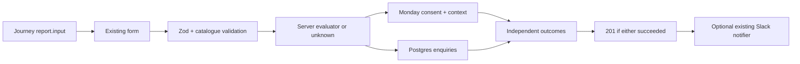

## Goal Capsule

Students can request contact without disclosing email to analytics, and operators receive useful leads even when one storage provider fails.

Means: validated server evaluation, independent Monday/Postgres delivery, existing Slack notification, and ID-only click events.

Authority: user brief and MyWay rules govern. One PR on codex/lead-path-privacy-tracking; no main push, merge, DB execution, environment or deployment changes. No visible copy, layout or input changes. Review pipelines are excluded by the Encoded restriction.

## Product Contract

### Summary

Harden the existing enquiry path and instrument existing actions.

### Problem Frame

Auth events expose email; enquiries have no evaluation context or backup, and relevant actions lack explicit analytics.

### Requirements

R1. Remove email from every analytics capture/identity/property path; authenticated identity uses Supabase ID only. Test outgoing payload privacy.
R2. Attach canonical program/institution IDs, server-derived accepted/below/eligible_to_apply/unknown status, and the validated evaluation inputs to Monday. Preserve simulation and saved-profile inputs actually used; do not add student fields.
R3. Independently attempt Monday and Postgres backup; either success returns 201. Log provider failures without submitted personal data. Missing table must preserve Monday delivery.
R4. Add Drizzle schema/migration and guarded, idempotent backup/apply/rollback packet at supabase/packets/2026-10-24-enquiries-table.sql. Deny anon/authenticated access; service-role access only. Leave all SQL unapplied.
R5. Reuse existing Slack configuration and notifier, no-op when unset. Notify after any accepted enquiry; notification failure cannot fail delivery.
R6. Track institution site/calculator, share, program contact/calculator clicks with stable names and only program_id/institution_id. Preserve markup, hrefs, text and styling.
R7. Failing-first proof for every feature; lint, typecheck, full unit suite, build, relevant desktop/mobile e2e, pre-push guard. Open one PR with required title and code-review skip line.

## Planning Contract

KTD1. Use report.input from the active journey evaluation rather than current editable draft; validate via the existing admissions Zod schema and recompute on the server. No client-supplied result status is accepted. Missing input or evaluation failure yields unknown.
KTD2. Monday's existing long-text column holds unchanged consent text followed by structured lead context and numeric score inputs (full subject record stays in Postgres, respecting Monday’s 2,000-character limit), in the same create_item write. This avoids a board schema change or a second context write that could fail independently. Official API create_item has no initial-update argument.
KTD3. Postgres request UUID is the primary key; insert conflict is an idempotent success. Both destinations run independently and settle before the response. The runtime DB uses server-only DATABASE_URL and an execute-only SECURITY DEFINER insert function; direct table access is restricted to service_role and the privileged owner. SQL grants no browser roles.
KTD4. Reuse readAdmissionsReviewSlackConfig/postAdmissionsReviewSlackMessage with SLACK_BOT_TOKEN and SLACK_READY_PR_CHANNEL_ID (legacy SLACK_ADMISSIONS_REVIEW_CHANNEL_ID fallback). Messages contain lead IDs and status, with a Monday link when available; no contact details.
KTD5. Tiny client link wrappers retain existing Link/anchor DOM. Share fires once per click regardless of native/clipboard outcome.

### Data flow

## Implementation Units

### U1. Analytics privacy (R1)

Files: src/components/AuthScreen.tsx, src/context/AuthContext.tsx, instrumentation-client.ts, src/lib/posthog-server.ts and privacy helper/tests if needed.
Approach: remove explicit email properties; identify initial and changed sessions by internal ID; apply payload email scrubbing at SDK boundaries for automatic URL/property capture too.
Tests: successful login/signup payloads exclude submitted email; identity receives only Supabase ID; nested/URL email fields cannot escape the sanitizer.
Execution note: observe failing tests before implementation.

### U2. Enquiry context (R2)

Files: src/lib/enquiries.ts, shared admissions schema, src/components/EnquiryForm.tsx, src/components/StudyJourney.tsx, src/app/api/enquiries/route.ts and corresponding tests.
Approach: optional report input; canonical catalogue validation and server recomputation; four-value status normalization; same-write Monday context.
Tests: accepted/below/eligible/unknown, invalid scores/status/pair rejected, evaluation failure does not block lead, simulated and saved inputs survive form submission, standalone has unknown/null context.
Execution note: observe failing API and component assertions first.

### U3. Independent backup and unapplied SQL (R3, R4)

Files: src/server/enquiries/*, src/db/schema.ts, src/db/migrations/0040*, supabase/packets/2026-10-24-enquiries-table.sql, scripts/pre-pr-guard.mjs and tests.
Tests: both success, Monday-only, DB-only, both failure, missing table, missing Monday token, provider timeout, duplicate request handling; migration/packet role restrictions and guarded rollback.
Execution note: run failure matrix before implementation. No live DB writes in any verification.

### U4. Notifications (R5)

Files: src/server/enquiries/notifications.ts and test; enquiry route.
Tests: unset config no-ops; configured accepted enquiry sends ID/status notification; Slack failure logged without breaking 201; no notification for total failure.
Execution note: mock all outbound delivery; failing-first proof.

### U5. CTA events (R6)

Files: client tracked links, src/components/ProgramShareButton.tsx, src/components/StudyJourney.tsx, src/components/RequirementTiles.tsx, src/app/programs/[programId]/page.tsx and tests; e2e/lead-path.spec.ts.
Tests: every named event fires on real clicks with exact two-property payloads; native/copy share; program page wiring; desktop/mobile journey submission has evaluation input and unchanged fields.
Execution note: observe missing events first, then implement without visible changes.

## Verification Contract

Run targeted tests after each unit. Run npm run lint, npm run typecheck, npm test, npm run build, relevant Playwright journey/enquiry/program tests and npm run guard:pre-pr before push. Use static local catalogue mode and intercepted enquiry delivery in e2e to prevent external writes. Inspect SQL without executing against production. Record all unavailable live verification explicitly in PR. Use ce-simplify-code before shipping; skip all review pipelines per user instruction.

## Definition of Done

All R1-R7 implemented and locally verified; abandoned code removed; consent and visible UI remain unchanged. SQL packet exists but has not been executed. One PR opened with required title and skip line; report URL, head SHA, notification channel and packet path. Live DB/apply verification remains an explicit operator action outside this task.
