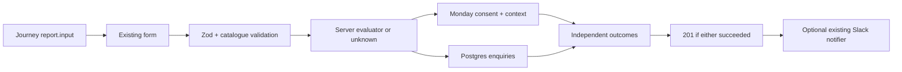

## Goal Capsule

Students can request contact without disclosing email to analytics, and operators receive useful leads even when one storage provider fails.

Means: validated server evaluation, independent Monday/Postgres delivery, existing Slack notification, and ID-only click events.

Authority: user brief and MyWay rules govern. One PR on codex/lead-path-privacy-tracking; no main push, merge, DB execution, environment or deployment changes. No visible copy, layout or input changes. Review pipelines are excluded by the Encoded restriction.

## Product Contract

### Summary

Harden the existing enquiry path and instrument existing actions.

### Problem Frame

Auth events expose email; enquiries have no evaluation context or backup, and relevant actions lack explicit analytics.

### Requirements

R1. Remove email and phone from every analytics capture/identity/property path; authenticated identity uses Supabase ID only. Test outgoing payload privacy.
R2. Attach canonical program/institution IDs, server-derived accepted/below/eligible_to_apply/unknown status, and score bands to Monday. Exact evaluation inputs are kept only in the private enquiries backup. Preserve simulation and saved-profile inputs actually used; do not add student fields.
R3. Independently attempt Monday and Postgres backup; either success returns 201. Log provider failures without submitted personal data. Missing table must preserve Monday delivery.
R4. Add Drizzle schema/migration and guarded, idempotent backup/apply/rollback packet at supabase/packets/2026-10-24-enquiries-table.sql. Deny anon/authenticated access; service-role access only. Leave all SQL unapplied.
R5. Reuse existing Slack configuration and notifier, no-op when unset. Notify after any accepted enquiry; notification failure cannot fail delivery.
R6. Track institution site/calculator, share, program contact/calculator clicks with stable names and only program_id/institution_id. Preserve markup, hrefs, text and styling.
R7. Failing-first proof for every feature; lint, typecheck, full unit suite, build, relevant desktop/mobile e2e, pre-push guard. Open one PR with required title and code-review skip line.

## Planning Contract

KTD1. Use report.input from the active journey evaluation rather than current editable draft; validate via the existing admissions Zod schema and recompute on the server. No client-supplied result status is accepted. Missing input or evaluation failure yields unknown.
KTD2. Monday's existing long-text column holds unchanged consent text followed by structured lead context and score bands, in the same create_item write. The enquiryScoreBands helper uses 50-point psychometric bands and 5-point Bagrut bands; decimal averages follow their floor bucket. Final bands include the valid maximum (750–800 and 115–120), avoiding a singleton perfect-score band. Missing scores stay null. Exact scores, institution-specific averages, subject scores and the full evaluation input stay only in Postgres. Monday receives no evaluation_input and stays within its 2,000-character limit. This avoids a board schema change or a second context write that could fail independently. Official API create_item has no initial-update argument.
KTD3. Postgres request UUID is the primary key; insert conflict is an idempotent success. Both destinations run independently and settle before the response. The runtime DB uses server-only DATABASE_URL and an execute-only SECURITY DEFINER insert function; direct table access is restricted to service_role and the privileged owner. SQL grants no browser roles.
KTD4. Reuse postAdmissionsReviewSlackMessage with SLACK_BOT_TOKEN for authentication and the dedicated SLACK_LEADS_CHANNEL_ID only. No-op when either is unset; never fall back to ready-PR or admissions-review channels. Messages contain only program/institution IDs and catalogue names, result status, utm_source when available, and a Monday link when available. Student contact details, free text, request IDs and other attribution fields are excluded.
KTD5. Tiny client link wrappers retain existing Link/anchor DOM. Share fires once per click regardless of native/clipboard outcome.

### Data flow

## Implementation Units

### U1. Analytics privacy (R1)

Files: src/components/AuthScreen.tsx, src/context/AuthContext.tsx, instrumentation-client.ts, src/lib/posthog-server.ts and privacy helper/tests if needed.
Approach: remove explicit email properties; identify initial and changed sessions by internal ID; apply recursive email/phone scrubbing at both SDK boundaries for automatic URLs, super properties and person properties too. Cover formatted Israeli/international numbers and ambiguous long numeric values; retain internal UUIDs and SDK Date timestamps.
Tests: successful login/signup payloads exclude submitted email; identity receives only Supabase ID; nested/URL email and phone fields cannot escape the sanitizer; phone distinct IDs drop the event rather than collapsing identity to a placeholder.
Execution note: observe failing tests before implementation.

### U2. Enquiry context (R2)

Files: src/lib/enquiries.ts, shared admissions schema, src/components/EnquiryForm.tsx, src/components/StudyJourney.tsx, src/app/api/enquiries/route.ts and corresponding tests.
Approach: optional report input; canonical catalogue validation and server recomputation; four-value status normalization; same-write Monday context.
Tests: accepted/below/eligible/unknown, invalid scores/status/pair rejected, evaluation failure does not block lead, simulated and saved inputs survive form submission, standalone has unknown/null context.
Execution note: observe failing API and component assertions first.

### U3. Independent backup and unapplied SQL (R3, R4)

Files: src/server/enquiries/*, src/db/schema.ts, src/db/migrations/0040*, supabase/packets/2026-10-24-enquiries-table.sql, scripts/pre-pr-guard.mjs and tests.
Tests: both success, Monday-only, DB-only, both failure, missing table, missing Monday token, provider timeout, duplicate request handling; migration/packet role restrictions and guarded rollback.
Execution note: run failure matrix before implementation. No live DB writes in any verification.

### U4. Notifications (R5)

Files: src/server/enquiries/notifications.ts and test; enquiry route.
Tests: unset leads channel no-ops even with development channels configured; a fixture containing student name, phone, email and free text produces only the allowed fields and contains no contact values or email/phone patterns; Slack failure logged without breaking 201; no notification for total failure.
Execution note: mock all outbound delivery; failing-first proof.

### U5. CTA events (R6)

Files: client tracked links, src/components/ProgramShareButton.tsx, src/components/StudyJourney.tsx, src/components/RequirementTiles.tsx, src/app/programs/[programId]/page.tsx and tests; e2e/lead-path.spec.ts.
Tests: every named event fires on real clicks with exact two-property payloads; native/copy share; program page wiring; desktop/mobile journey submission has evaluation input and unchanged fields.
Execution note: observe missing events first, then implement without visible changes.

## Verification Contract

Run targeted tests after each unit. Run npm run lint, npm run typecheck, npm test, npm run build, relevant Playwright journey/enquiry/program tests and npm run guard:pre-pr before push. Use static local catalogue mode and intercepted enquiry delivery in e2e to prevent external writes. Inspect SQL without executing against production. Record all unavailable live verification explicitly in PR. Use ce-simplify-code before shipping; skip all review pipelines per user instruction.

## Definition of Done

All R1-R7 implemented and locally verified; abandoned code removed; consent and visible UI remain unchanged. SQL packet exists but has not been executed. One PR opened with required title and skip line; report URL, head SHA, notification channel and packet path. Live DB/apply verification remains an explicit operator action outside this task.

## Attribution and short-link addendum

R8. Capture utm_source, utm_medium, utm_campaign and document.referrer at the first session visit; retain even an empty first touch in sessionStorage across internal navigation and reloads. Use session-only PostHog super properties and attach the same validated attribution to every enquiry destination. No contact fields or visible text change. Campaign values are capped at 100 characters without content filtering; referrers keep safe origin/path only, with query/fragment/credentials and recognizable email/phone data excluded.
R9. Redirect /tt, /ig, /fb, /wa to /?utm_source=tiktok, instagram, facebook, whatsapp respectively. No inbound medium/campaign convention exists; do not add either. Redirect-only paths remain absent from sitemap.
R10. Clear the unused admissions import and format the migration snapshot; require CI=true npm run lint -- --max-warnings 0, typecheck and CI format check. CI logs show format:check, rather than the unused-import warning, caused the original red job.

### U6. Session attribution (R8)

Use a shared Zod attribution contract in src/lib/leadAttribution.ts and a browser session helper. Initialize before interaction through instrumentation-client.ts; register session super properties in the SDK loaded callback before the initial pageview. Read the captured session in EnquiryForm without additional fields. Optional attribution preserves older clients. Validate again in the enquiry API and persist four nullable, bounded columns through the existing insert function. Include the fields in Monday's existing context and successful server analytics. Keep the existing independent-write guarantees and 2,000-character Monday limit.

Update the existing unexecuted 0040 migration and its snapshot rather than creating a second table-creation path. The guarded packet must also upgrade an existing enquiries table idempotently with ADD COLUMN IF NOT EXISTS, preserving all RLS/grants, backup and archival rollback behavior. The packet stays unapplied.

Tests first: source persistence across changed URLs/module reload; empty direct first touch wins; unavailable storage cannot break contact; unknown attribution keys are stripped and oversized values rejected; PostHog independently scrubs PII; referrer query/fragment stripped on client and server; initial PostHog pageview receives session props; form retries retain attribution; API sends normalized attribution to Monday, DB and analytics; schema columns and bounded SQL function values; maximum-size Monday context stays within its limit.

### U7. Redirects (R9)

Use the existing proxy/NextResponse.redirect mechanism before auth session lookup. Exact path matches redirect to the landing URL with only the channel source. Tests assert status and exact target for all four paths, unaffected non-matches, and sitemap exclusion. Browser verification follows a short link into a journey/enquiry, changes the URL later, and verifies the original session attribution remains.

### Addendum verification

After implementation and ce-simplify-code, run lint with zero warnings, typecheck after the build has finished generating Next types, full units, production build, format check, migration consistency and the existing pre-push guard. Use existing Playwright Chromium, static local catalogue and intercepted lead submissions. Exercise desktop/mobile lead flow and redirect HTTP targets. Update PR #273 body and push once on the same branch; no additional PR, production SQL, env/config change, main push or merge.

## Jorje B2 ruling (2026-10-25)

Monday retains the documented score bands; exact academic inputs and the evaluation record remain in the private enquiries backup. A failing-first regression serializes the complete Monday GraphQL body (item name, every column and Lead context) for bagrut 105.5, psychometric 680 and a separate what-if 750, including a crafted source path and unsupported attribution key. None of those exact inputs may escape through those fields. Names and bounded campaign strings are preserved verbatim, including numbers that happen to resemble scores; they are not academic score fields and are not censored.

The shared source-path guard accepts only page patterns derived from src/app, after removing query and fragment; unknown paths such as /680 become /. Both the API and each delivery adapter apply the guard. A route-tree test detects new pages missing from the guard. Attribution allows only utm_source, utm_medium, utm_campaign (100 characters each) and the existing referrer field. Unsupported keys are stripped; UTM values have no syntax or score/PII content filtering in storage. Referrer URL privacy normalization and independent PostHog email/phone scrubbing remain in place. The private DB keeps exact score inputs. No SQL packet is executed.
