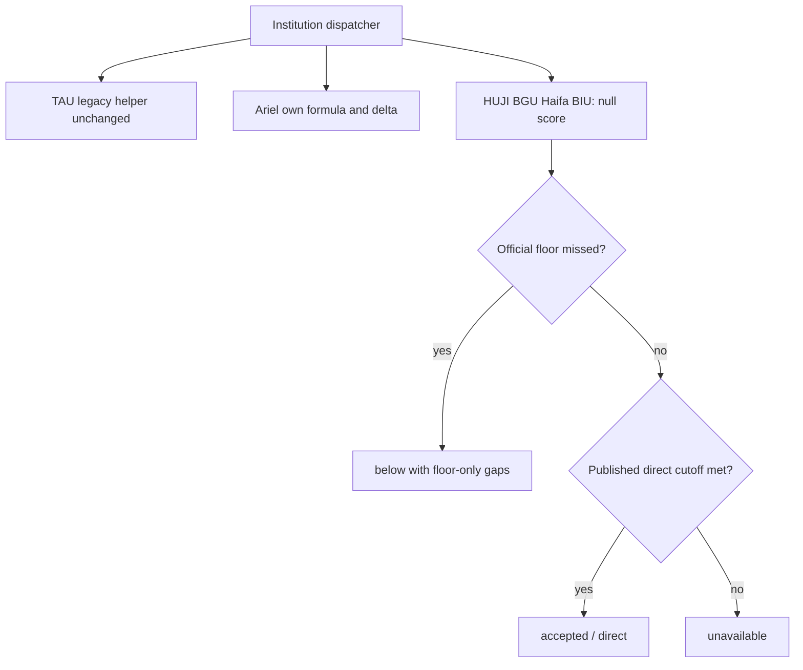
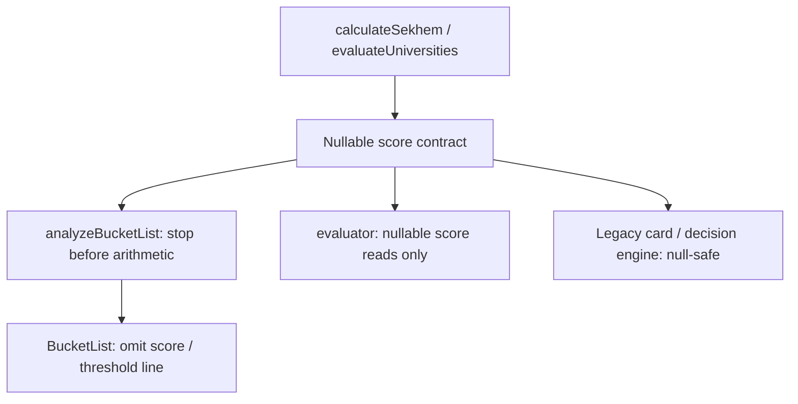

# Ariel-only Bagrut Normalization - Plan

## Goal Capsule

Prospective students must not receive invented composite admission scores for HUJI, BGU, Haifa, or BIU. Ariel must use its published formula, while TAU keeps its existing results until postfreeze-2.

This delivery is a local plan and intentionally failing tests, based on `b39067a8f7b2cbf5c53d9fccdd6763456e248dff`, on `codex/bagrut-normalization-ariel-only`. Implementation is a separate commit after the freeze is lifted. No production code, data, scripts, remote writes, DB operations, environment changes, push, PR, rebase, or merge are authorized now.

Authority: the user brief and Addendum 1 override conflicting spec/skill instructions. The final external spec is `../codex-tasks/postfreeze-5-bagrut-normalization.md` (workspace task document, outside this repository; read-only). Its final Handoff to Oded and 18-pin table govern this plan. Standing rules and admissions accuracy workflow were read from the same task directory.

---

## Product Contract

### Summary and Problem Frame

Option A removes the unbacked conversion from four legacy institution calculators. Their published floors and direct psychometric routes remain checkable. Clearing floors alone supplies no composite verdict. Verified/live adapters and BIU published routes remain unchanged.

Ariel uses `(6.666 × B + P) / 2`, with derivatives `0.5` for P and `3.333` for B. It gets its own branch/function, never a general conversion helper. Ariel expectations are **text-verified, calculator not run**.

### Requirements

**Institution calculations**

- R1. Preserve TAU's `sekhemWeighted` → `normalizeBagrut` calculation, coefficients, engineering bonus, clamp, and numerical results byte-for-byte in the executed calculation path. Keep the function name. Re-comment it as **TAU legacy only, unbacked, until postfreeze-2**.
- R2. Dispatch Ariel separately to its literal published formula and derivatives.
- R3. For HUJI/BGU/Haifa/BIU, `calculateSekhem` and `calculateDelta` return `null`. No partial HUJI/Haifa formula is allowed.
- R4. In `evaluateUniversities`, those four always carry `sekhem: null`, including missing-threshold results. A missed official floor gives `below` with the existing explanation and floor-gap delta only. A met direct track gives `accepted`/`direct`. Otherwise return `unavailable` without composite delta.

**Consumers and tooling**

- R5. `UniversityResult.sekhem` becomes `number | null`. Bucket-list analysis must stop before rounding/comparison when no score exists, carrying no number and no composite delta.
- R6. BucketList hides the whole score/threshold line for null scores. Retain the existing card, contact/save actions, and right-aligned Hebrew. No invented score, zero substitute, or estimate label.
- R7. UniversityCard and admissionsDecisionEngine receive null-safety only; no deletion. The server evaluator changes only reads of `evaluation.sekhem`.
- R8. Ariel's script uses 6.666. BGU/BIU scripts print `not found: no published bagrut conversion` and no computed score or composite-based verdict.
- R9. Keep all 18 pins, source-scan guard, null-render tests, and no-estimate API tests. Existing TAU assertions stay untouched.

### Sources and Expected-Value Authority

These are citations to the **final spec's sources table**, not a fresh live-source verification. Captures are relative to the external official-capture root `../pm-research/raw/official/`.

| Key | Institution / authority | Official source and capture | What it justifies |
|---|---|---|---|
| S-Ariel | Ariel sources-table row | [Registration process](https://www.ariel.ac.il/wp/registration-and-acceptance/הליך-הרשמה-לתואר-ראשון/), `ariel/ba-registration-process.2026-10-25.md:15` | Literal 6.666; 683.30 / 799.96 / 433.315; rounded 683; delta 20/4 |
| S-HUJI | HUJI sources-table row | [Weighted acceptance](https://info.huji.ac.il/reception-channels/Kabala_Meshklal), [Bagrut](https://info.huji.ac.il/reception-components/Bagrut), `huji/Kabala_Meshklal.2026-10-25.md:5–8`, `huji/Bagrut.2026-10-25.md:11` | Published institution scale differs; no legacy 200–800 composite |
| S-BGU | BGU sources-table row | `bgu/yedion-bsc.2026-10-25.txt:808–828`; [Summative scores](https://www.bgu.ac.il/welcome/contents/pre-registration/summative-scores-calculation/), `bgu/summative-scores-calculation.2026-10-25.txt:249–267` | No published conversion; do not invent one. Independent floors stay as encoded |
| S-Haifa | Haifa sources-table row | [Score calculation](https://admissions.haifa.ac.il/score-calculation/), `haifa/score-calculation.2026-10-25.txt:92–97,102–160,321–331` | A different, year/programme-dependent formula; no partial substitute |
| S-BIU | BIU sources-table row | [Matriculation calculation](https://www.biu.ac.il/registration-and-admission/information/general-admission-req/matriculation-calculation), `biu/matriculation-calculation.2026-10-25.md:6–10` and `biu/general-admission-req.2026-10-25.txt` | Bonuses do not establish a composite; deferral matches BIU plan KTD3 |
| S-scope | Final Handoff / user Addendum 1 | 18 pins and explicit TAU sequencing | TAU values are legacy regression values, not an official accuracy claim |

No HUJI or Haifa alternative formula, coefficient, or threshold rescaling is included. Their source uncertainties belong to later briefs. No `reviewedManifest` canonical change is needed because catalogue data and weights do not change.

---

## Planning Contract

- KTD1. Add institution dispatch before generic weighted arithmetic, preserving TAU's existing expressions (session-settled: user-directed — chosen over sharing Ariel's conversion: Ariel's formula is institution-specific). Covers R1–R4.
- KTD2. Use explicit nullable scores, never `0` or arithmetic coercion (session-settled: user-directed — chosen over a fabricated numeric placeholder: consumers must distinguish no estimate). Covers R3–R7.
- KTD3. Reuse bucket status `no-data` for absent estimates, with `sekhem: null` and no delta. When scores are present, use concise Hebrew such as `בדקו תנאי קבלה` instead of the current misleading `ממתין לציונים`. No redesign or additional helper paragraphs. Covers R5–R6.
- KTD4. Pin 14 uses outputs through existing public functions, plus source scanning, because module-internal `normalizeBagrut` cannot be spied on reliably. Assert TAU's legacy value, Ariel's distinct literal value, and null for the other four. This proves observable separation, not internal call history.
- KTD5. Confine the scanner's TEMPORARY TAU allowlist to the existing named normalization function and existing weighted call site; `postfreeze-2 removes this`. Allow only literal 6.666 within an Ariel-only function/branch and its script. Do not allowlist the entire utility or script. TAU's derivative can reuse the same legacy conversion of one unit within a TAU-only branch, preserving its numeric value while removing the separately copied conversion expression.

### High-Level Technical Design





### Assumptions

Missing threshold for one of the four must also produce null, otherwise pin 18 catches the old unavailable/zero result. Floor checks precede direct admission in the new four-institution branch, following the brief's ordered outcomes. Existing HUJI psychology has no conflicting floor; do not invent a conflicting-fixture policy from unrelated institutional routes.

The global `weighted_scaled` type remains for compatibility. Existing generic test institutions, Reichman, Afeka, Technion, and minimum-floor colleges retain current behavior.

---

## Implementation Units

### U1. Nullable institution calculations

**Requirements:** R1–R4, KTD1–KTD2. **Dependencies:** none.

**Files:** `src/utils/sekhemCalculators.ts`, `src/types/index.ts`, `src/utils/__tests__/bagrutNormalization.optionA.test.ts`, `src/utils/__tests__/sekhemCalculators.test.ts`, `src/utils/__tests__/bagrutNormalization.sourceScan.test.ts`.

Add an Ariel-only `sekhemAriel` function (or an explicit Ariel dispatcher branch) and its derivative dispatch. The source guard accepts that name or `calculateArielSekhem`, and only the literal 6.666 within that function/branch. Add the four-institution null dispatch and floor/direct evaluation path before score arithmetic. Widen return types. Re-comment generic formula claims, including `src/types/index.ts:19`. Retain TAU's helper name and calculation expressions. Replace the separately copied derivative expression with reuse of the legacy TAU conversion, restricted to TAU, so the source guard does not bless a second conversion site.

**Execution note:** make the already-written tests pass; update only the two approved old expectations listed below.

**Test scenarios:** pins 1–14, 17–18; four null delta cases; missing thresholds, high-score floors-met profiles, direct track, and BGU floor-only gaps. Existing minimum-floor, Reichman, Afeka, and Technion tests remain green. Pin 17 and the existing TAU pins must pass unchanged.

### U2. Nullable consumers and saved-program rendering

**Requirements:** R5–R7, KTD2–KTD3. **Dependencies:** U1.

**Files:** `src/utils/bucketListEngine.ts`, `src/components/BucketList.tsx`, `src/components/UniversityCard.tsx`, `src/utils/admissionsDecisionEngine.ts`, `src/server/admissions/evaluator.ts`, `src/components/BucketList.bagrutNormalization.test.tsx`, `src/utils/__tests__/bagrutNormalization.optionA.test.ts`.

Widen `BucketEntry.sekhem` to accept null and return no-data/null without delta before rounding a null score. Hide the full badge when null even if a qualified/gap entry is encountered. Distinguish unavailable formula from missing scores using existing profile/status context and concise copy. Make legacy formatting, comparisons, and explanations null-safe without deleting dead code. Server evaluator changes only its three `evaluation.sekhem` reads (`:2308`, `:2325`, `:2476` on base), using the existing nullable result shape and avoiding a score label when appropriate; do not change route selection or capability classification.

**Test scenarios:** every saved programme across pin-18 profiles carries no numeric score for the four; no composite delta; mock null entries in both qualified/gap card states render no score/threshold line; retain programme title and remove action. A real engine run is covered separately by pin 18, so the render test isolates the consumer contract.

### U3. Standalone scripts

**Requirements:** R8. **Dependencies:** none.

**Files:** `scripts/admissions-calculators/8_ariel.js`, `scripts/admissions-calculators/4_bgu.js`, `scripts/admissions-calculators/5_biu.js`, `scripts/admissions-calculators/__tests__/bagrutNormalization.test.ts`.

Ariel uses its own published literal formula. BGU/BIU stop printing invented composites and composite verdicts, reporting the exact not-found message. Use the existing Vitest runner and Node child-process pattern; no new runner/package scripts.

**Test scenarios:** pins 15–16; additionally Ariel B99.9/P701 rounds to 683 under the official constant, versus 684 today. Pin 15 itself passes today because rounding hides the small formula difference.

### U4. Evidence and implementation verification

**Requirements:** R9. **Dependencies:** U1–U3.

**Files:** `docs/admissions-verification/2026-10-25-bagrut-normalization.md` (new in implementation commit); this plan if evidence requires correction. No other implementation files are planned.

Record source confidence, before/after coverage, actual test results, and direct browser evidence when implementation is authorized. Produce desktop/mobile screenshots for a saved programme at each affected institution; Jorje obtains Amit's visual approval before shipping. Do not declare this red-tests commit merge-ready.

**Test expectation:** no new runtime behavior in the verification document.

---

## Grep Table at b39067a

Exhaustive tracked-repository search, including hidden tracked files, excluding node_modules/dist/.git. Overlapping matches share a row. Command:

```bash
git grep -n -I -e normalizeBagrut -e sekhemWeighted -e '800 / 120' -e /120 -e '6\.66' b39067a -- ':!node_modules' ':!dist'
```

213 matching lines: 11 rows retained below, 200 Chrome/120 user-agent lines ignored because they describe browser versions, and 2 `src/data/journeyGeography.ts:22,37` SVG path lines ignored because digits are coordinates. Compared Eitan's `../scratch/pf5-grep.2026-10-25.txt` from c3739c3; meaningful src/scripts hits and line numbers agree. Whole-repository search additionally finds two brand SVG files; these are listed rather than silently dropped.

| File:line at base | Hit / purpose | Planned action |
|---|---|---|
| `public/brand/myway-wordmark-inverse.svg:3` | 6.66 substring in vector path coordinates | keep; non-formula asset |
| `public/brand/myway-wordmark.svg:3` | 6.66 substring in vector path coordinates | keep; non-formula asset |
| `src/types/index.ts:19` | `/120` generic weighted formula comment | change to accurate scope |
| `src/utils/__tests__/sekhemCalculators.test.ts:39` | 696.6667 TAU bonus pin | test-only; keep |
| `src/utils/__tests__/sekhemCalculators.test.ts:46` | 686.6667 TAU baseline pin | test-only; keep |
| `src/utils/sekhemCalculators.ts:21` | normalizeBagrut declaration | keep name/body; re-comment TAU-only |
| `src/utils/sekhemCalculators.ts:36` | sekhemWeighted declaration | keep TAU math; re-comment |
| `src/utils/sekhemCalculators.ts:38` | normalizeBagrut call | keep expression byte-identical; four/Ariel dispatch earlier |
| `src/utils/sekhemCalculators.ts:90` | sekhemWeighted dispatcher call | keep TAU path; add earlier institution branches |
| `src/utils/sekhemCalculators.ts:135` | `/120`, normalizeBagrut chain-rule comment | change scope/comment |
| `src/utils/sekhemCalculators.ts:136` | `800 / 120` derivative expression | change copied conversion to TAU-only legacy helper reuse; preserve TAU derivative value |

The requested literals omit spaced conversions. Supplement with:

```bash
git grep -n -F '/ 120' b39067a -- src scripts
```

| File:line at base | Purpose | Planned action |
|---|---|---|
| `src/utils/sekhemCalculators.ts:22` | legacy helper body | keep byte-identical, TEMPORARY TAU exception |
| `src/utils/sekhemCalculators.ts:34` | generic weighted formula comment | change misleading generalization |
| `src/utils/sekhemCalculators.ts:136` | derivative expression (also above) | change as above |
| `scripts/admissions-calculators/8_ariel.js:14` | copied conversion | change to Ariel 6.666 |
| `scripts/admissions-calculators/4_bgu.js:15` | copied conversion | change to not-found output |
| `scripts/admissions-calculators/5_biu.js:15` | copied conversion | change to not-found output |

No hit is grounds for editing Eitan's data lane. Weights at `src/data/degreesData.ts:6–53`, seed copying at `src/db/seeds/catalogueSeed.ts:183–194`, and `src/lib/calculatorInstitutions.ts` stay unchanged.

### Source-scan contract

Scan source-like files recursively under `src/` and `scripts/`. Exclude `__tests__`, `*.test.*`, `*.spec.*`, `__fixtures__`, and `fixtures` so tests, scanner examples, and TAU expected values cannot self-trigger. Strip only Chrome/120 version tokens and journeyGeography `d:` SVG-coordinate literals; do not skip an entire source file. Match division by 120 in any whitespace, 800 divided by 120, and 6.66 constants across whitespace/newlines. Diagnostics list every offending file:line.

Use syntax-tree ranges to allow the existing `normalizeBagrut` function, its existing weighted call, and an Ariel-only named function or explicit Ariel branch. Only Ariel's exact literal 6.666 is permitted there and in `8_ariel.js`; that script's old /120 remains an offense. New shared helpers are not exceptions. The scan deliberately flags generic comments, `calculateDelta`'s copied conversion, and BGU/BIU scripts today. Output tests remain necessary because scanning cannot prove every data-flow path or detect algebraically disguised conversion.

---

## Lines 39/46/53 of src/utils/__tests__/sekhemCalculators.test.ts

**TAU, unchanged, moves in postfreeze-2**. Values 696.6667, 686.6667, and the 800 clamp are the existing TAU regression pin and remain untouched in this commit and the normalization implementation.

Addendum 1 supersedes the earlier no-duplicate instruction: add the dedicated named pin-17 test, `TAU regression: unchanged by postfreeze-5`, with baseline 686.6667, bonus 696.6667, cap 800. Postfreeze-2 deliberately changes baseline/bonus/cap to 639.192 / 649.192 / 786.2328 respectively with the TAU source citation.

---

## Approved test update

For Jorje: only the following existing expected values are authorized to move in the implementation commit. They are **not edited in this tests-only commit**.

| Existing test / line | Current → implementation | Citation / preserved behavior |
|---|---|---|
| `src/utils/__tests__/sekhemCalculators.test.ts:91`, `does not accept a weighted-scale programme when the official psychometric floor is unmet` | 706 → null | S-BGU, spec pin 7 and Existing tests that legitimately move. Keep below, 547, psychometric-floor explanation, P10/B0 delta |
| `src/utils/__tests__/sekhemCalculators.test.ts:109`, `does not accept a weighted-scale programme when the official bagrut floor is unmet` | 682 → null | S-BGU, spec pin 8 and Existing tests that legitimately move. Keep below, 585, B106-floor explanation, P0/B6 delta |

A repository call-site/test audit found no other existing expectation of HUJI/BGU/Haifa/BIU legacy composite results. Existing evaluator estimate tests concern Reichman/Afeka; exact adapter and BIU route expectations remain. Capability tests classify metadata without calling this utility. Existing bucket tests cover requirements, missing profile, and missing threshold rather than the four composites. Existing HUJI direct status and Technion tests pass unchanged. If execution exposes another old expected-value change, list it with S-HUJI/S-BGU/S-Haifa/S-BIU and concrete failing test before updating; no uncited numeric changes.

---

## Dead code

Verified by `rg -n 'UniversityCard|ResultsDashboard|admissionsDecisionEngine|evaluateAdmissionsDecision' src`: UniversityCard is imported only by ResultsDashboard, whose only other reference is an AppExperience test mock. No production component mounts ResultsDashboard. The decision engine is defined in its utility and imported only by its unit tests. Thus neither is mounted in prod; the card has an indirect dead dashboard reference rather than a direct test import.

Plan: **null-safe only, no deletion**. UniversityCard currently formats before checking unavailable, and divides a score for progress; guard formatting/progress and omit absent score content. Decision-engine explanations must not interpolate `null` as a score. Keep both APIs and preserve existing fixtures.

---

## Spec ambiguities / lane notes

1. The initial spec changed during research; the final spec and Addendum 1 now explicitly require 18 pins including the duplicate named TAU pin. This supersedes the original no-duplicate restriction.
2. The final spec still says rename/re-comment; preserve `normalizeBagrut`'s name and exact TAU calculation per explicit user direction.
3. Final spec leaves null versus omission open; the user settled `UniversityResult.sekhem: number | null` and null returns. BucketEntry accepts null; no numeric zero substitute, even for unavailable/missing-threshold cases.
4. Pins 4, 12, 13, 15, and 17 pass today by design; they are regression guards, not claimed red tests. Pin 15 cannot distinguish constants after integer rounding. The additional CLI boundary detects that gap.
5. Pin 18's required profiles are P/B 650/100, 750/115, 520/88. They include floors-met and floor-missed cases; all three public APIs are covered. Exact adapters/published routes are out of this guard.
6. The source scan requires removal of copied `calculateDelta` conversion even though TAU math stays unchanged. Reuse the preserved TAU helper only within the TAU derivative path; never change TAU's observable derivative or normalizer body to appease the scan.
7. Floors before direct is the literal outcome order used for the new branch. No current HUJI psychology conflict exists. Institution-specific alternate-channel interpretation stays with Eitan; do not invent new floors.
8. B55 is a utility input pin for the future postfreeze-0 range change; no input UI range/validation work here.
9. Capability classifications are not legacy runtime coverage. Unsupported matrix counts may be unchanged even when 50 bucket scores disappear. Static catalogue measurements are not production DB measurements or traffic.
10. Ownership: Oded implements bucketListEngine/BucketList/UI and shared type consumers; Eitan reviews admission accuracy and owns `src/data/admissions/**`, `src/data/degrees/**`. Do not edit those paths, `src/data/degreesData.ts` weights, or the catalogue seed. No external coordination messages are authorized in this run.
11. Current no-data label implies missing scores; when a profile exists and conversion is unavailable, use KTD3's concise action. Visual approval and screenshots are owed during implementation, not claimed by these component tests.
12. Freeze/queue rules forbid shipping now. This explicitly authorized plan/tests commit does not implement or lift the freeze. Source captures are supplied evidence; Ariel's live calculator was not run. HUJI/Haifa follow-ups, input range, TAU accuracy, data cleanup, schema/data changes, and deployment are out of scope.

---

## Verification Contract

### Verification

Implementation commit commands, using real package.json scripts:

```bash
npm run lint
npm run typecheck
npm test
npm run build
```

Focused red-tests command for this delivery:

```bash
npx vitest run src/utils/__tests__/bagrutNormalization.optionA.test.ts src/utils/__tests__/bagrutNormalization.sourceScan.test.ts src/components/BucketList.bagrutNormalization.test.tsx scripts/admissions-calculators/__tests__/bagrutNormalization.test.ts
npx vitest run
npm run typecheck
```

Scripts are included by `vitest.config.ts` (`scripts/**/*.test.ts`); there is no separate script runner. `npm ci` was required because node_modules was absent. No live database tests, browser/deployment checks, or production writes are part of this local red-tests delivery. Before any later authorized push, run `npm run guard:pre-pr` without bypassing hooks. For implementation UI verification use the existing browser/E2E workflow, desktop and mobile, with filled scores and unavailable estimates; record any unavailable capability explicitly.

### BEFORE / AFTER coverage

Independently computed on **b39067a**, using only static catalogue and in-memory utilities: 403 programmes, 436 linked pairs. Bucket list has **109 numeric rows**, of which **50 lose their number**: HUJI 13, BGU 11, Haifa 15, BIU 11. Expected AFTER: **59 numeric rows**, with **zero** for those four. TAU 33, Ariel 19, Technion 7 keep scores. This exactly reconciles with the final spec's c3739c3 count despite the later base. Loss is 45.9% of numbered programmes, 12.4% of all static programmes. Jorje's notification to Amit is required before a later merge, not sent here.

Re-run this same command before and after implementation (P650/B100 is the first required guard profile):

```bash
npx tsx -e 'import {allPrograms} from "./src/data/degrees"; import {analyzeBucketList} from "./src/utils/bucketListEngine"; import {UNIVERSITIES} from "./src/data/degreesData"; const rows=analyzeBucketList(allPrograms.map(p=>p.id),{bagrut:100,psychometric:650}); const by:Record<string,number>={}; for(const e of rows.filter(e=>typeof e.sekhem==="number")){const ids=Object.entries(e.program.thresholds??{}).filter(([,t])=>t!==null).map(([id])=>id);const id=UNIVERSITIES.some(u=>u.id===e.program.institutionId)?e.program.institutionId:ids.find(id=>UNIVERSITIES.some(u=>u.id===id));by[id??"unknown"]=(by[id??"unknown"]??0)+1;} console.log(JSON.stringify({programs:allPrograms.length,rows:rows.length,numeric:rows.filter(e=>typeof e.sekhem==="number").length,byInstitution:by},null,2));'
```

The matrix count is **37 unsupported**, with `missing` counted separately (**1**). Exact call: `getStaticCataloguePrograms().flatMap(program => buildAdmissionsCapabilityMatrix({program, institutions: getStaticCatalogueInstitutions()}))`; filter exactly `entry.capability === 'unsupported'`. Pair identities are programme ID plus institution ID. Use the same static inputs and empty default freshness map for BEFORE and AFTER; do not inject fake fresh authority.

```bash
npx tsx --conditions=react-server -e 'import {getStaticCataloguePrograms,getStaticCatalogueInstitutions} from "./src/lib/catalogueStatic"; import {buildAdmissionsCapabilityMatrix} from "./src/server/admissions/capabilityMatrix"; const institutions=getStaticCatalogueInstitutions(); const rows=getStaticCataloguePrograms().flatMap(program=>buildAdmissionsCapabilityMatrix({program,institutions}).map(entry=>({programId:program.id,...entry}))); console.log(JSON.stringify({pairs:rows.length,unsupported:rows.filter(e=>e.capability==="unsupported").length,missing:rows.filter(e=>e.capability==="missing").length,byInstitution:Object.fromEntries(["huji","bgu","haifa","biu","ariel","tau"].map(id=>[id,rows.filter(e=>e.institutionId===id).reduce((a,e)=>(a[e.capability]=(a[e.capability]??0)+1,a),{} as Record<string,number>)]))},null,2));'
```

| Institution | Pairs | unsupported | Other capabilities on base |
|---|---:|---:|---|
| huji | 22 | 2 | authority_unavailable 20 |
| bgu | 21 | 0 | authority_unavailable 20; score_only 1 |
| haifa | 20 | 1 | authority_unavailable 18; needs_input 1 |
| biu | 19 | 9 | estimated 7; manual_gate 3 |
| ariel | 25 | 24 | tracked_missing_rule 1 |
| tau | 33 | 1 | authority_unavailable 29; manual_gate 3 |

**The matrix does not reflect the legacy evaluateUniversities path:** it never calls it and has no nullable-score awareness. Expect its static unsupported count to remain 37 if metadata stays untouched. Measure the actual effect with numeric bucket rows and pin 18, not by changing capability data. Do not infer runtime support from `estimated` or `score_only` classifications alone.

The final spec reports **0 evaluator pairs on the normalization path** in its three-profile simulation, with 32 scored pairs through other rules. This run cross-checked matrix classifications and bucket coverage, not that full evaluator simulation. Treat zero as supplied spec evidence, not a claim of a fresh authenticated/API/production check. At implementation, repeat the spec's in-memory `evaluateAdmissionsForProgram` simulation with the same profiles, rich extra inputs, failing live fetcher, and empty freshness map; record actual legacy calls and unsupported decisions. Do not change evaluator control flow to force the matrix count to match the bucket loss.

### Local test results

Focused run: **31 cases: 26 intended failures, 5 passing regression guards**, exit 1. All four files loaded and ran; no import, missing-file, compilation, or fixture failures. An initial ambiguous component title query was corrected before these final runs; both component failures now specifically expose the score/threshold span.

Full `npx vitest run --reporter=json --outputFile=/tmp/postfreeze5-full.json` run: **4,140 total; 4,028 passed; 26 failed; 86 skipped** (exit 1). All failed cases belong to these four new files. The **267 pre-existing test files contain 4,023 passed, zero failed, 86 skipped** cases. Vitest's JSON suite counters include nested describes (633 total suites, 7 failed); those are not file counts. There are 271 file results, four with intentional failures. Existing integration skips remain skips, not newly proven DB behavior.

`npm run typecheck` / `tsc --noEmit`: **exit 0**, no new or existing type errors. Re-run after formatting also passed. Targeted ESLint on all four added files: zero errors; the repo deliberately ignores `scripts/**` and reports one ignored-file warning for the script test. Prettier formatted only the four new tests. Lint/build for production implementation are listed above, not claimed as executed for this red-tests delivery.

Focused JSON: `/tmp/postfreeze5-focused.json`; full JSON: `/tmp/postfreeze5-full.json`; output logs use matching `.log` paths; typecheck log: `/tmp/postfreeze5-typecheck.log`. These local scratch artifacts are not committed. All verification is local; no DB, environment, Vercel, remote, or production checks were performed.

The source scan's exact diagnostic locations on base are `scripts/admissions-calculators/4_bgu.js:15`, `scripts/admissions-calculators/5_biu.js:15`, `scripts/admissions-calculators/8_ariel.js:14`, `src/types/index.ts:19`, and `src/utils/sekhemCalculators.ts:34,135,136`. The preserved normalizer body and Chrome/SVG noise are correctly excluded.

#### src/components/BucketList.bagrutNormalization.test.tsx

| Test name | Result / actual failure message |
|---|---|
| `hides the full score/threshold line when qualified has null sekhem` | expected <span …(1)></span> to be null The span contains `/ ≥547` despite null sekhem. |
| `hides the full score/threshold line when gap has null sekhem` | expected <span …(1)></span> to be null The span contains `/ ≥547` despite null sekhem. |

#### scripts/admissions-calculators/__tests__/bagrutNormalization.test.ts

| Test name | Result / actual failure message |
|---|---|
| `pin 15: Ariel B100/P700 prints sekhem 683` | passes: regression guard |
| `Ariel B99.9/P701 uses 6.666 at an integer-rounding boundary` | expected [ 'Computed Sekhem: 684', …(10) ] to deeply equal [ 'Computed Sekhem: 683', …(10) ] |
| `pin 16: 4_bgu.js reports no published conversion and no composite` | expected 'BGU Calculator Query: Bagrut=100, Psy…' to contain 'not found: no published bagrut conver…' Also still prints numeric composites and Accepted/Rejected verdicts. |
| `pin 16: 5_biu.js reports no published conversion and no composite` | expected 'BIU Calculator Query: Bagrut=100, Psy…' to contain 'not found: no published bagrut conver…' Also still prints numeric composites and Accepted/Rejected verdicts. |

#### src/utils/__tests__/bagrutNormalization.optionA.test.ts

| Test name | Result / actual failure message |
|---|---|
| `pin 1: Ariel B100/P700 equals 683.3` | expected 683.3333333333334 to be close to 683.3, received difference is 0.033333333333416704, but expected 5e-7 |
| `pin 2: Ariel B120/P800 equals 799.96` | expected 800 to be close to 799.96, received difference is 0.03999999999996362, but expected 5e-7 |
| `pin 3: Ariel B55/P500 equals 433.315` | expected 433.3333333333333 to be close to 433.315, received difference is 0.01833333333331666, but expected 5e-7 |
| `pin 4: Ariel evaluateUniversities B100/P700 rounds to 683` | passes: regression guard |
| `pin 5: Ariel deficit 10 requires 20 psychometric or 4 bagrut points` | expected { psychometric: 20, bagrut: 3 } to deeply equal { psychometric: 20, bagrut: 4 } |
| `pin 6: HUJI without a direct track and with floors met is unavailable` | expected 'accepted' to be 'unavailable' // Object.is equality |
| `pin 7: BGU EE preserves its psychometric floor result without sekhem 706` | expected 706 to be null |
| `pin 8: BGU biology preserves its bagrut floor result without sekhem 682` | expected 682 to be null |
| `pin 9: 'bgu' with floors met is unavailable` | expected 'accepted' to be 'unavailable' // Object.is equality |
| `pin 10: 'haifa' with floors met is unavailable` | expected 'accepted' to be 'unavailable' // Object.is equality |
| `pin 11: 'biu' with floors met is unavailable` | expected 'accepted' to be 'unavailable' // Object.is equality |
| `pin 12: HUJI psychology P660/B90 retains accepted/direct admission` | passes: regression guard |
| `pin 13: Technion CS P701/B101 remains 85.1` | passes: regression guard |
| `pin 14: only TAU retains the legacy normalization output` | expected 683.3333333333334 to be close to 683.3, received difference is 0.033333333333416704, but expected 5e-7 |
| `TAU regression: unchanged by postfreeze-5` | passes: regression guard |
| `pin 18: no numeric sekhem in any of the three legacy APIs for the four institutions` | 9822 numeric sekhem leaks; first examples: All are numeric behavioral leaks; first examples identify public API, programme, institution, profile and value. |
| `huji calculateDelta returns null because no composite derivative is published` | expected { psychometric: 19, bagrut: 4 } to be null |
| `bgu calculateDelta returns null because no composite derivative is published` | expected { psychometric: 23, bagrut: 3 } to be null |
| `haifa calculateDelta returns null because no composite derivative is published` | expected { psychometric: 14, bagrut: 6 } to be null |
| `biu calculateDelta returns null because no composite derivative is published` | expected { psychometric: 17, bagrut: 4 } to be null |
| `huji bucket-list analysis has no score or composite delta` | expected 'qualified' to be 'no-data' // Object.is equality |
| `bgu bucket-list analysis has no score or composite delta` | expected 'qualified' to be 'no-data' // Object.is equality |
| `haifa bucket-list analysis has no score or composite delta` | expected 'qualified' to be 'no-data' // Object.is equality |
| `biu bucket-list analysis has no score or composite delta` | expected 'qualified' to be 'no-data' // Object.is equality |

#### src/utils/__tests__/bagrutNormalization.sourceScan.test.ts

| Test name | Result / actual failure message |
|---|---|
| `pin 18 source scan: conversions occur only in temporary TAU code or Ariel own formula` | Unapproved bagrut conversions: Seven offending sites listed below. |


---

## Definition of Done

For this delivery: only this plan and test files are committed locally; all 18 pins are represented; all existing tests still pass; failures are the new behavioral assertions; typecheck introduces no test errors; source diagnostics enumerate real conversion sites. Record each case and outcome. No implementation or external write is performed.

For the later implementation: red cases pass, only approved old BGU expectations change, all TAU pins pass unchanged, numeric coverage is 59/0 for the stated sets, source scan passes without broad allowlists, existing verified routes remain intact, lint/typecheck/tests/build pass, and Jorje completes source/product/visual verification before any merge decision.
