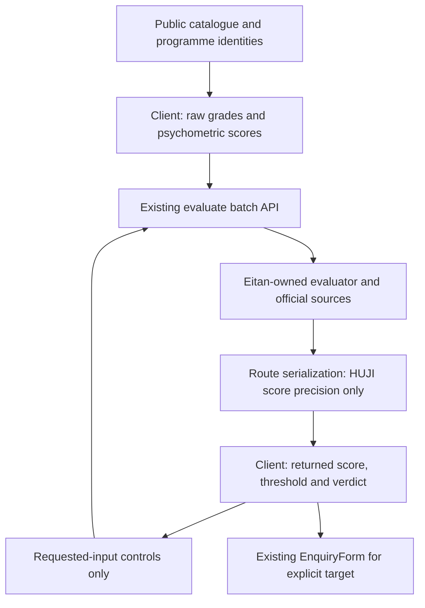

# Sekhem calculator public page - Plan

## Goal Capsule

Students enter ordinary exam scores and receive the evaluator's programme-specific score, threshold and honest verdict, then use the existing enquiry flow for an explicit institution/programme.

Implementation authority: Phase 2 approved on 2026-10-28, on `codex/sekhem-calculator-page`, baseline HEAD `215548a`. Use ce-work, tests first, then ce-simplify-code and logical local commits. No push, PR, code-review pipeline, production requests or database writes. The approved decisions below supersede earlier proposals and unresolved decision wording in this planning record.

### Phase 2 approved decisions (authoritative)

- Select links from rendered thresholds, excluding Ariel sources generically: 41 static programme pages (42 minus nutrition). FAQ links exclude TAU adaptation-only answers generically: 11 answers (14 minus tau_accounting, tau_business, tau_law). Keep existing FAQ answer text assertions intact where possible.
- Single no-composite line: `בחלק מהמוסדות נבדקים תנאי קבלה בלי חישוב סכם.` Afeka retains `יש גם אפיקי קבלה נוספים`; Ariel is absent throughout this page.
- HUJI wire scores use two decimals, medicine three, after raw decisions. Do not transform thresholds, gaps, snapshots or verdicts.
- Use `סף קבלה`, `הציונים עומדים בתנאי הקבלה`, `הציונים מתחת לסף`, `חסרים נתונים לחישוב`; remove repeated formula-year text. Average copy: `ממוצע הבגרות מחושב לפי כללי המוסד כשאפשר; אחרת מוצג אומדן.`
- Never render `נדרשת בדיקה מול המוסד`. A manual-gate row names only the actual API-returned gate; no gate and no number becomes missing input. HUJI psychology Kidum remains suppressed: its text-only API result receives no reconstructed numbers.
- Every institution group with a verdict has a prominent `קבלת מידע על התוכנית` CTA targeting an explicit real pair. Show `בחירת תוכנית` only when selection is needed.
- Every displayed result number must derive from that same API row. No published threshold backfill; Reichman retains `אומדן, עד לאישור המוסד`.
- Absolute metadata title prevents the root template adding a second suffix. Homepage link sits directly under StudyJourney's main action; no nav changes.
- Delete calculatorCoverage and its test/references; preserve its aggregate baseline independently. Keep sekhemCalculators.ts completely unchanged.
- Required full checks: lint, typecheck, npm test, build, new Playwright spec, format:check, guard:pre-pr; repeat after simplification. Enquiries are intercepted before navigation and mocked in unit tests.

Authority: this updated brief, then `../codex-tasks/myway-rules.md` in full, `AGENTS.md`, and `docs/ui-style-guide.md`; formula/threshold work follows `../codex-tasks/admissions-accuracy-workflow.md`. The approved mockup, copy and evidence under `../design/mockups/calculator-landing/` remain read-only inputs. Navigation is excluded. The live evidence is `../pm-research/admissions-coverage-2026-10-28.md` and `../pm-research/cov/final.json`; no audit script was executed and no live audit was repeated.

---

## Product Contract

### Summary

Build `/sekhem-calculator` as a public batch-API consumer. Collect raw subject rows, psychometric total and its verbal/quantitative/English sections. Reveal optional Haifa inputs only when the latest evaluator response requests them. Round HUJI's serialized score in the existing evaluate route, after all decisions are computed. Retire the unused coverage registry; preserve the legacy calculator where production callers still require it.

### Problem Frame

The mockup used a legacy dispatcher rather than the live evaluator. The supplied audit demonstrates broad official-calculator coverage, including score-bearing manual-gate results. A new UI must expose that coverage without duplicating formulas, hiding pending input needs, or racing Eitan's evaluator fixes.

### Requirements

**Scores and API boundary**

- R1. Send subject/units/grade rows and psychometric total plus sections through `POST /api/admissions/evaluate` in batch mode. Never request an institutional composite.
- R2. Render only scores, thresholds, metric labels and verdicts actually returned by that API. No import/use of `sekhemCalculators.ts`, coverage-registry classification, local composite calculation, hidden-score reconstruction or fabricated threshold.
- R3. Preserve `kind`, `capability`, `decision`, `scoreAssessment`, missing inputs, source failures and score-only limits. A psychometric/Bagrut route value is not a composite merely because it is numeric.
- R4. Round only HUJI's serialized `score`; compute every verdict and comparison on the unrounded evaluator value. Keep thresholds, gaps, decisions, source evidence and snapshot hashes unchanged.
- R5. The initial request omits Haifa average and Hebrew extras. Show an optional control only for a matching latest `needs_input.requiredInputs` entry; hide it and stop sending its stale value when that requirement disappears.

**Presentation and discovery**

- R6. This is the only page allowed to display a student's composite. Exclude Ariel entirely from calculator targets/output. One shared line represents the genuinely uncomputable set; preserve Reichman's estimate label and Afeka's alternative-routes link.
- R7. Reuse raw-grade controls, one `WayPageShell` and the existing R7e `EnquiryForm` from PR #307 / `ffbad6e`. Reuse consent, attribution, focus and delivery behaviour without enquiry API/schema changes.
- R8. Preserve requested SEO and contextual internal links. Select published numeric composite thresholds from resolved display data, outside `src/data/**`.
- R9. Prove API-to-page parity, serializer boundaries, response-driven optional fields, honesty, SEO and intercepted enquiry behaviour. Never weaken existing expected numerical values.

### Hard lane boundary

**EITAN-LANE planned changes: NONE.** No modification to `src/server/admissions/evaluator.ts`, `evaluationInputs.ts`, `bagrutPolicies.ts`, either official adapter `src/server/ingestion/adapters/technionAdmissions.ts` / `hujiAdmissions.ts`, any `src/data/**`, `src/app/api/admissions/evaluate/aliases.test.ts`, catalogue, reviewedManifest or institution rule/evaluation files. These may be read or imported by existing infrastructure; their ownership does not move into this feature.

The earlier proposals for `compositeDetails`, evaluator output seams, Reichman/MTA evaluator edits, shared admissions type edits and provenance-policy changes are removed. No replacement formula or serializer-side evaluator is planned. If the API omits an internally computed score, this page cannot expose it within this lane and must show the returned route or an honest missing-composite state.

---

## Planning Contract

### 1. Updated approach and architecture

KTD1. **The API is the sole calculation boundary.** The async server page loads public catalogue context through `loadPublicCatalogue` (`src/lib/publicCataloguePages.ts:31`) and passes serializable programme/institution identities to a client island. The client uses existing `fetchAdmissionsBatch` (`src/lib/admissionsEvaluationClient.ts:45`) and its ordinary-input mapping helpers. It never imports the server evaluator or a calculator formula. The endpoint keeps existing catalogue loading, validation, source verification and bounded concurrency (`src/app/api/admissions/evaluate/route.ts:24`, `:64`).

Scope is the available public degree programmes for TAU/HUJI/BGU/Haifa/Technion plus the named Reichman/BIU/Afeka/HIT contexts, rather than nine fixed mockup examples. Other existing programme contexts such as MTA can be opened from a programme link without claiming universal catalogue coverage. Group results by institution with compact programme rows/disclosures. Programme choice/context uses real public catalogue records, not a copy of the audit inventory in production code.

Resolve generic subject entries to their existing institution-programme destination when available. Deduplicate request degree IDs and render identities by institution plus resolved programme identity, not the Hebrew programme name or the most favourable response. Do not introduce `haifa_psychology -> psychology` or `cs -> biu_cs` exceptions. An alias-specific failure stays visible as returned; Eitan's ID fixes will change the next response without a UI patch. Generic entries with no specific programme destination retain their own programme ID; do not merge all of them by institution URL.

Send sequential chunks of at most 50 unique degree IDs; render completed batches progressively. Respect the existing 16 KiB payload bound, rate limit of12 requests/minute, per-batch four-programme concurrency and official timeouts. Submit explicitly, invalidate results when inputs change, ignore stale responses, preserve successful rows on partial failure and retry failed IDs without a loop. Do not repeatedly evaluate on every keystroke or poll production for coverage.

KTD2. **Reuse ordinary input handling, not institutional average algorithms.** Extract the controlled subject rows from `JourneyExactGrades.tsx:185` for shared use. Reuse `ALL_SUBJECTS`/`SECTORS`, `buildBagrutSubjectRecord`, `subjectIdForWizardLabel`, and `admissionsExtraInputsFromAcademicScores` (`src/lib/admissionsEvaluationProfile.ts:15`). Preserve entered rows and zero grades; reject duplicates and invalid integers before the builder can filter them. Ranges remain subjects1–5 units, grades0–100, total200–800, sections50–150. Do not synthesize a Hebrew subject or a missing section score.

The existing API client already adds a unit-weighted generic average and `bagrutAverageEstimated: true` if omitted (`admissionsEvaluationClient.ts:71`); that is an existing transport compatibility behaviour, not a new institutional average formula. The page supplies the raw record and actual section values, not invented TAU/BGU/Haifa averages. Existing record/certificate metadata must remain truthful. Do not introduce a full-matriculation confirmation checkbox; unresolved sector/certificate context is handled in section6, not by changing policies.

The shared profile mapper can also project paired legacy fields. Omit a projected pair when its actual units/grade cannot satisfy the stricter HTTP schema (for example grade0 or units1–2); keep the original raw subject row intact. Never clamp a failed grade to50, discard it, or alter the subject record to make validation pass. Characterize any resulting missing-input gate against the evaluator rather than correcting it in the page.

KTD3. **Let required inputs drive the optional UI.** After a response requests `haifa_bagrut_average`, reveal `ממוצע בגרות בחיפה` as an optional continuation input for those rows. After `haifa_hebrew_qualification`, reveal the existing Hebrew qualification choices; reveal Hebrew score/date only when requested. Reuse schema/labels/options in `src/lib/haifaAdmissionsInputs.ts:77` and a filtered mode of `HaifaQualificationFields`, instead of placing its whole questionnaire on the page. Other Haifa facts such as month, year or track appear only when actually requested and within agreed UI scope; otherwise offer the existing full calculator.

Requirement visibility is scoped to the latest completed response for the current input version. A new raw-profile submission starts without obsolete Haifa overrides; when the response no longer requests one, unmount its control and exclude its old value from subsequent requests. This handles Eitan's future average deriver and any future Hebrew derivation/default without a page change. Share common Haifa facts between affected rows, but do not infer qualification from interface language or psychometric total.

KTD4. **Map returned metrics and verdicts without reinterpretation.** A finite score, its returned label and its same-result threshold are displayed together. Preserve ordinary score labels such as `פסיכומטרי` when a direct route wins; do not relabel700 as sekhem. `manual_gate` with an official composite (Haifa) remains a scored row. A missing score, null threshold, `needs_input`, stale/unverified source or withheld manual result does not become a computed admission match. Use the returned decision/scoreAssessment for the verdict; never recompute it from a rounded number.

Use locale number formatting for presentation, retaining the three-decimal HUJI medicine exception. Ordinary non-HUJI HTTP values are unchanged by the serializer; an estimated Reichman value639.1652 may display639.17 with its estimate label. Mapping tests assert the explicit formatting contract as well as the underlying API value, rather than treating every formatted string as an unrounded calculation.

Recommend putting Afeka/BIU **no-score** results in the single shared non-composite treatment, with detail links to their existing route/floor checks; do not create a grid of accepted/estimated badges with blank scores. A scored manual-gate result is different and is retained. Exact proposed shared line: **`בחלק מהמוסדות נבדקים תנאי קבלה בלי חישוב סכם.`** Keep a named Afeka link labelled **`יש גם אפיקי קבלה נוספים`**. Jorje/Amit must confirm this presentation decision. Reichman retains **`אומדן, עד לאישור המוסד`**, even if its returned route is direct psychometric. Do not recover its suppressed coordinated score by importing the legacy helper.

KTD5. **Round HUJI only at serialization.** Add a pure `src/lib/admissionsEvaluationSerialization.ts` helper called immediately before both `Response.json` returns (`route.ts:97`, `:122`). Copy the report/batch and transform finite HUJI result scores only; preserve other institutions and all unknown/additive response fields. No mutation of the evaluator report, recalculation, threshold rounding, comparison, digest regeneration or input transformation.

For ordinary HUJI feed scores, propose **two decimal places**: `21.116181701499997 -> 21.12`, `19.620647354000003 -> 19.62`. No retained official general-track presentation rule was found in the repo. `scripts/admissions-calculators/1_huji.js:50` formats three places, but it is a discovery script, not official presentation proof. Flag two decimals for Jorje confirmation rather than attributing it to HUJI.

There is official **medicine-specific three-decimal** evidence: retained official calculator functions and observations in `docs/admissions-verification/2026-09-28-huji-medicine-official.json:7`, `:9`, from `https://www.huji.ac.il/documents/medicine_calc.htm`. Preserve those three-decimal cognitive/final medicine values, e.g.27.921, rather than generalizing the ordinary-track proposal to medicine. Integer direct psychometric scores remain numerically unchanged. This exception uses existing report programme context, not a copied medical formula.

Verdicts remain those already computed on the raw value (`src/server/ingestion/adapters/hujiAdmissions.ts:83`). For a raw score21.119 below threshold21.12, wire score21.12 must still carry `below`; the page must not infer equality means acceptance. Existing snapshots continue describing the original evaluator computation (`src/server/admissions/evaluationSnapshot.ts:38`); preserve them byte-for-byte and test that contract. The wire score is a presentation value, not a replacement input for alerts or future comparisons.

**Execution note:** in the later implementation, first write the NEW route serialization test against current POST handling and observe failure specifically because the HTTP response contains the long float; then add the helper and route wiring. No test is run during this planning phase.

KTD6. **Reuse the lead flow intact.** The single CTA below results opens `EnquiryForm` with the explicitly selected real programme/institution pair, returned report input, `surface="sekhem_calculator"` and a return callback. Use the existing R7e title/consent/prep-consent behaviour; no new enquiry backend or attribution model. Multiple results require an explicit target choice, not a silent lead recipient. All tests intercept `/api/enquiries` before navigation, including retry/success cases.

KTD7. **Keep SEO changes local.** Exact title: `מחשבון סכם וסיכויי קבלה לפי מוסד ותוכנית | MyWay`. Exact description: `מחשבון סכם וסיכויי קבלה בחינם: מזינים ציוני בגרות ופסיכומטרי, מחשבים סכם לפי נוסחאות המוסדות הנתמכים וממשיכים לבדיקת התוכנית שמעניינת אותך.` Canonical: `https://findmyway.co.il/sekhem-calculator`, including contextual query URLs. Use an absolute title to avoid duplicating the root suffix. Add one llms link and sitemap entry with a real authored content date, never build/request time. Homepage insertion belongs directly after the primary action in `StudyJourney.tsx:847`, labelled `מחשבון סכם וסיכויי קבלה`.

Programme/FAQ links use rendering selectors outside `src/data/**`. Programme page gets one component insertion; matching JSON-LD FAQ answers get a fixed internal anchor with a visible counterpart beside their existing facts. Preserve the current33-programme FAQ allowlist, questions, freshness answers and all published facts. Narrowly update exact expected answer strings for the intentional anchor addition; do not relax existing number/copy assertions. No new visible FAQ accordion or nav work.

**Next16:** package versions remain Next16.4.2 / React19.2.7. `node_modules` is absent; installed Next guides could not be read. Use the repository's async server catalogue, promised params/searchParams and client-island patterns in this plan. Before any implementation touching Next APIs, read the installed relevant guides under `node_modules/next/dist/docs/`. One `WayPageShell`; root layout already owns the footer. Do not install or launch Next in this phase.

### 2. Exact implementation file list

This is the planned later diff, not changes made now. **EITAN-LANE: NONE.** No types/evaluator/policy/data changes are required. The overlap tags reflect #317's supplied and previously inspected file list; recheck after integration.

| Tag | File | Purpose |
|---|---|---|
| [new] | `src/app/sekhem-calculator/page.tsx` | Public server page, metadata and live catalogue programme context. |
| [new] | `src/app/sekhem-calculator/error.tsx` | Visible catalogue error/retry without static fallback. |
| [new] | `src/components/sekhem/SekhemCalculator.tsx` | Raw form, batch requests, progressive results and existing enquiry modal. |
| [new] | `src/components/sekhem/SekhemCalculatorResults.tsx` | Returned metrics, thresholds/verdicts, shared no-composite line and Afeka link. |
| [new] | `src/components/sekhem/RequiredAdmissionsInputs.tsx` | Response-driven optional inputs and stale-field removal. |
| [new] | `src/components/BagrutSubjectRows.tsx` | Controlled shared raw subject/units/grade/remove controls. |
| [modify] | `src/components/JourneyExactGrades.tsx` | Reuse extracted rows without altering its existing workflow. |
| [modify] | `src/components/HaifaQualificationFields.tsx` | Optional visible-field filter/compact mode; retain current default mode. |
| [new] | `src/lib/sekhemCalculator.ts` | API-result mapping, programme identities and request/required-input state; no formula code. |
| [new] | `src/lib/sekhemCalculatorPage.ts` | Approved copy, exact metadata and truthful modification-date constant. |
| [new] | `src/lib/admissionsEvaluationSerialization.ts` | Immutable HUJI wire-score rounding, including medicine precision exception. |
| [modify] | `src/app/api/admissions/evaluate/route.ts` | Apply the helper to existing single and batch responses after evaluation. |
| [delete] | `src/server/admissions/calculatorCoverage.ts` | Retire the unused stale institution-level registry/aggregate wrapper. |
| [delete] | `src/server/admissions/calculatorCoverage.test.ts` | Retire tests of that dead registry; preserve independent pair invariant below. |
| [modify] | `scripts/pre-pr-guard.mjs` | Remove retired test reference; include new calculator/serialization paths and focused suites. |
| [modify] | `.github/workflows/ci.yml` | Replace retired targeted-suite reference with its retained pair-invariant test; no new workflow. |
| [new] | `src/lib/admissionsCoverageRetirement.test.ts` | Preserve live pair-coverage aggregate expectations against authoritative helpers, without the stale registry. |
| [new] | `src/lib/admissionsEvaluationSerialization.test.ts` | Precision, immutability, identity, raw-verdict preservation and medicine exception. |
| [new] | `src/app/api/admissions/evaluate/serialization.test.ts` | Test-first HTTP single/batch rounding regression; never edit aliases.test.ts. |
| [new] | `src/lib/sekhemCalculator.test.ts` | Response mapping, chunk/identity handling and no formula inference. |
| [new] | `src/lib/sekhemCalculatorGuard.test.ts` | New path/suite guard coverage and removal of retired test references. |
| [new] | `src/app/sekhem-calculator/page.test.tsx` | Server catalogue/context handling and error boundary contract. |
| [new] | `src/components/sekhem/SekhemCalculator.test.tsx` | Ordinary inputs, batching/errors and intercepted lead interactions. |
| [new] | `src/components/sekhem/SekhemCalculator.mapping.test.tsx` | Evaluator -> serialized API -> real page mapping, using official fixture transports. |
| [new] | `src/components/sekhem/RequiredAdmissionsInputs.test.tsx` | Haifa fields appear only when requested and disappear after derivation succeeds. |
| [new] | `src/test/fixtures/sekhemCalculatorResponses.json` | Small curated, non-PII wire examples from the supplied audit; not a runtime coverage source. |
| [new] | `src/test/fixtures/sekhemCalculatorCatalogueDelta.json` | Captured minimal Reichman/Wingate snapshot records for display-source merge/link regressions. |
| [new] | `src/lib/publishedCompositeThresholds.ts` | Shared numeric published-threshold selector over resolved display requirements. |
| [new] | `src/lib/publishedCompositeThresholds.test.ts` |42-page/14-FAQ static and37-page/15-FAQ snapshot inventory, with negative cases. |
| [new] | `src/components/seo/SekhemCalculatorLink.tsx` | One compact contextual link driven by that selector. |
| [new] | `src/components/seo/SekhemCalculatorLink.test.tsx` | Matching, deduplication and unrelated/no-data cases. |
| [modify] #317-OVERLAP | `src/app/programs/[programId]/page.tsx` | Minimal import/render insertion using existing resolved requirement sources. |
| [modify] | `src/lib/seo/jsonLd.ts` | Fixed calculator anchor in matching admission FAQ answers only. |
| [modify] #317-OVERLAP | `src/lib/seo/seo.test.ts` | Exact answer-string updates for the anchor, retaining all existing facts/assertions. |
| [modify] | `src/components/StudyJourney.tsx` | One homepage link directly below the main button. |
| [modify] | `src/app/sitemap.ts` | Public calculator URL with actual content-modification date. |
| [modify] | `public/llms.txt` | One discovery link, without thresholds or personal scores. |
| [new] | `src/app/sekhem-calculator/seo.test.tsx` | Exact metadata, sitemap/llms/home/programme/FAQ links. |
| [new] | `e2e/sekhem-calculator.spec.ts` | Real calculator/optional-field/lead browser flow with enquiry interception. |
| [new] | `docs/admissions-verification/2026-10-28-sekhem-calculator-page.md` | Actual API/provenance checks and residual evaluator limitations, no new formulas. |
| [modify] | `design-qa.md` | Later actual-preview1280/390 evidence and approval limitations. |

Current-run change: this plan only. `sekhemCalculators.ts` and all its importers remain unchanged. Existing API client/profile helpers and all `src/data/**` are reused read-only. Any additional required file is a scope amendment, not silent permission to enter Eitan's lane.

**#317 integration:** let it merge first, then merge main into this branch without rebase/force-push. Preserve its programme metadata and SSR whitespace. Only the two tagged files overlap its current change set. Avoid root page.tsx, shared metadata helpers, institution pages, navbar/footer, CatalogueLinks and its e2e files. Recheck the exact diff at implementation time; do not edit .github Actions beyond the existing targeted-test references required here.

### 3. Live composite coverage, verified against code

Evidence is the supplied2026-10-28 audit, not new production calls. `final.json` contains **445 unique `(pid, inst)` results**; its `tag` identifies the winning audit pass, not duplicate pass rows. For the five universities it contains123 raw ID pairs and78 institution/programme-name groups. Keep both identities in research; do not implement name-based programme merging.

The audit's **58/78** means score-bearing groups: TAU17, HUJI11, BGU7, Haifa14, Technion9. Two are direct psychometric values: TAU business700/680 and BGU psychology700/680. Strictly **56/78 return composites in this sample**;58/78 return a numeric route score. This qualifies the audit's wording without denying its broad coverage. These are profile-dependent observations, not permanent support counts or student-facing marketing statistics.

| Institution | Audit groups / score-bearing | Computed programme IDs and kinds | Source seam / page treatment |
|---|---|---|---|
| TAU |20 total;17 numeric,16 composite. Kinds16 exact,2 manual_gate,1 requirements_only,1 needs_input. | Composite families: `cs/tau_cs`, `datascience/tau_datascience`, `ee/tau_ee`, `me/tau_me`, `tau_industrial`, `psychology/tau_psychology`, `law/tau_law`, `economics/tau_economics`, `biology/tau_biology`, `accounting/tau_accounting`, `social_work/tau_socialwork`, `occupational_therapy/tau_occupational_therapy`, `communication`, `political_science`, `education`; `nursing` is scored manual_gate. `business/tau_business` returns direct psychometric for this profile. | Official GraphQL adapter `src/server/ingestion/adapters/tauAdmissions.ts:81`; dispatch `src/server/admissions/evaluator.ts:1369`; TAU average derivation `evaluationInputs.ts:23`. Show returned score/metric/threshold/verdict: CS695/705 below; accounting639/610 accepted. Do not “fix” repeated600/610 scores in the UI. |
| HUJI |13 total;11 composites;11 exact,1 manual_gate,1 needs_input. | `cs/huji_cs`, `law/huji_law`, `business/huji_business`, `economics/huji_economics`, `datascience/huji_datascience`, `huji_biology`, `huji_accounting`, `huji_occupational_therapy`, `huji_socialwork`, `nutrition`, `pharmacy`. `psychology/huji_psychology` is Kidum manual_gate in this profile; `medicine/huji_medicine` needs specialised inputs. | Official feed coefficients/track thresholds in `src/server/ingestion/adapters/hujiAdmissions.ts:42`, `:83`; dispatch `evaluator.ts:1320`. CS19.620647354/23.75 below and economics21.1161817015/20.75 accepted become wire19.62 and21.12. Psychology direct725+ remains psychometric, not composite; preserve its suppressed Kidum score. |
| BGU |18 total;7 numeric,6 composite;6 exact,1 manual_gate,4 authority_unavailable,3 degraded,4 unsupported. | Composites `cs/bgu_cs`, `datascience/bgu_datascience`730/720 pending; `bgu_nursing`648/520 eligible_to_apply/manual_gate; `medicine/bgu_medicine`648/735 below; `occupational_therapy`718/620 pending; `physiotherapy`718/667 pending. `psychology/bgu_psychology` uses direct psychometric700/680 accepted in this pass. | Official score adapter `src/server/ingestion/adapters/bguAdmissions.ts:114`, `:276`; specialised dispatch `evaluator.ts:698`, `:766`, `:813`, `:1110`, `:1159`, `:1296`; BGU average derivation `evaluationInputs.ts:22`. Keep pending distinct and allow Eitan's fixes to arrive through the response. |
| Haifa |17 audit name groups;14 scored manual_gate/eligible_to_apply,2 needs_input,1 authority_unavailable. | `cs/haifa_cs`, `law/haifa_law`, `economics/haifa_economics`, `biology/haifa_biology`, `social_work/haifa_socialwork`, `nursing/haifa_nursing`, `accounting/haifa_accounting`, `communication` and `haifa_communication` (different audit names), `political_science/haifa_politicalscience`, `haifa_statistics`, `haifa_math`, `physiotherapy/haifa_physiotherapy`, `haifa_sociology`, generic `psychology`. | Official servlet `src/server/ingestion/adapters/haifaAdmissions.ts:14`, `:50`; dispatch `evaluator.ts:957`, `:1009`. CS706/700 and law702/680 are scored results despite manual_gate. The two communications names count separately in the audit; do not turn that reporting convention into a UI identity rule. |
| Technion |10 audit name groups;9 scored exact,1 degraded. | `cs/technion_cs`84.4/91; `datascience/technion_datascience`84.4/91 (different audit names); `ee/technion_ee`84.4/91.5; `me/technion_me`84.4/87; `technion_civil`84.4/87; `technion_biomedical`84.4/87; `technion_industrial`84.4/89; medicine aliases include a score-only result. | Official calculator `src/server/ingestion/adapters/technionAdmissions.ts:19`, `:79`; dispatch `evaluator.ts:1217`. The audit added a Hebrew row to bypass today's input bug; the page must not synthesize that row. `technion_medicine` has score84.4 but no admission threshold/verdict (`evaluator.ts:232`); do not copy92 from the generic alias. |

**Pairs that do not return a composite, or need further input**

| Set | Recorded status / IDs | What this page shows |
|---|---|---|
| TAU residual | `architecture` manual_gate/no score; `medicine/tau_medicine` requirements_only/no score; `physiotherapy` needs `tau_physiotherapy_route`. | No number or copied cutoff. Missing-input cases remain actionable, distinct from absent formula support. |
| HUJI residual | `psychology/huji_psychology` manual_gate/unknown atP700; medicine needs its actual medical-route fields. | Text-only Kidum result; contextual link to full calculator for specialised inputs. No reconstructed hidden ordinary score. |
| BGU unverified | `biology/bgu_biology`, `business/bgu_business`, `economics/bgu_economics`, `accounting/bgu_accounting`: authority_unavailable/pair verification incomplete. | One shared no-composite treatment, with programme-specific retry/detail access. Stored thresholds do not make these computable today. |
| BGU stale | `ee/bgu_ee`, `me/bgu_me`, `bgu_industrial`: degraded/source_stale. | No legacy replacement score; retain failure reason in details and allow retry after Eitan's backend fix. |
| BGU blocked/unsupported | `education`, `political_science`, `communication`, `social_work/bgu_socialwork`. | Shared no-composite treatment; no invented green/threshold comparison. |
| Haifa residual/ID mismatch | `haifa_psychology` authority_unavailable while generic `psychology` scores702/650; `haifa_infosystems` needs track; `occupational_therapy` needs selection-history facts. | Do not substitute generic psychology for a failed specific ID. Show returned requirements or full-calculator link; no hidden hard-coded alias workaround. |
| Technion residual | `architecture` degraded/no score; normal Jewish record lacks the currently required extra `hebrew` row. | Actual needs_input/error until backend fix. Do not collect a fake Hebrew grade or switch to the −18 legacy formula. |
| BIU |12 audit name groups:8 estimated floor-route groups without scores,4 unsupported; specific `biu_cs` differs from generic `cs`. `biu_law` unknown versus generic law below in this profile. | Recommended decision: collapse no-score floor results into the shared line and link to actual floor checks; no blank-score success cards. If product chooses verdict-only rows instead, they must say ordinary conditions, never composite. |
| Afeka | `afeka_cs`, `afeka_softwareeng`, `afeka_ee`, `afeka_biomedical`: exact/accepted, no score/threshold. | Same proposed shared no-composite treatment, plus the required named alternative-routes link. Never display legacy287. Ref: `src/server/admissions/afekaPublishedRoutesEvaluation.ts:55`, `:120`. |
| Reichman |5 estimated programme results plus manual `reichman_infosystems`. `reichman_economics` returns coordinated639.1652/600 pending; business/law return direct psychometric700/700 pending; CS/psychology below with no returned score. | Show returned estimated score where present with `אומדן, עד לאישור המוסד`; no-score entries use the shared treatment/details. Do not compute a missing coordinated value. Ref: `src/server/admissions/reichmanPublishedRoutesEvaluation.ts:154`, `:217`. |
| HIT | `hit_cs` unsupported; `hit_visual_comm`, `hit_industrial_design` manual_gate/no score. | Shared no-composite treatment; no psychometric masquerading as sekhem. |
| Ariel |20 unsupported programme groups in the audit. | No target, row, badge or institution name in calculator output; no formula use. Existing published thresholds elsewhere are not removed. |
| MTA/other contexts |Some existing college results carry ordinary or combined scores; others are floor/manual/requirements-only. | If opened in context, use the API's returned metric and cap. No implied coverage from stored calculator weights. |

The runtime proof/verification paths, not `calculatorCoverage.ts` or `sekhemCalculators.ts`, explain the live coverage. TAU/HUJI/BGU/Haifa/Technion official paths bypass the legacy dispatcher, while some central evaluator fallback paths and Reichman's estimated helper still depend on it. Section5 below lists those retained dependencies rather than claiming the module is globally dead.

**Audit-profile limitation:** these numbers are evidence of successful official requests, not golden output for a raw-rows-only form. `cov/run.py` sends an explicit generic Bagrut92.1; its nine rows total30 units/2580 points, actually86.0. `run2.py` explicitly adds institutional averages104 and sections; its external-certificate record cannot itself exercise BGU's internal-certificate average deriver. Pass3 adds the extra Hebrew row; pass4 adds actual Haifa qualification/year/month facts. `cov/body.json` also marks92.1 as derived despite those rows; do not replay it as a valid payload. Tests must use truthful raw inputs and evaluator outputs for those same inputs, not copy audit overrides into the page. No new production call was made to investigate these discrepancies.

### 4. Corrected programme-page and FAQ-answer link inventory

**Deterministic selector:** resolve the same public requirement sources used by rendering/FAQ generation (`src/lib/publicCataloguePages.ts:185`). Select listed academic, canonical, non-`mon_` pages whose resolved institutional requirements contain a numeric published composite threshold. Recognize `סכם` and quantitative/engineering/architecture variants, `ציון התאמה` including management, **`מתואם` as well as `מתאם`**, `מצרף` and `ציון משולב`, with attached threshold syntax/ranges. Reject a formula coefficient, year, ordinary psychometric-only floor or generic explanation. Include published-but-uncomputed routes and retain cycle/alternative qualifications.

Use the existing current-DB-first/static-missing-ID merge, generic-provider resolution and reviewed Technion winter prefix at `publicCataloguePages.ts:31`, `:230`. Deduplicate by canonical page identity, not institution rows. For FAQs, intersect generated `programFaqPageLd` admission answers; do not create a new FAQ allowlist or edit data. The new selector/components and `src/lib/seo/jsonLd.ts` own linking; all `src/data/**` stays read-only.

**Correction to the previous plan:** its36-page static count missed five Reichman `מתואם` pages plus the `economics` subject page. Correct static coverage is **42 canonical page IDs:25 institution pages +17 general subject pages**, with **14 threshold-bearing FAQ answers**. The originally expected25 is therefore the static institution-page count, not all link contexts. The11 expected FAQs excludes the three TAU adaptation-score answers; those also qualify, yielding14.

Read-only replay of display-source selection against supplied `cov/programs.json` merged with missing static IDs gives **37 snapshot page IDs:21 institution pages +16 subject pages**, with **15 FAQ answers**. This is supplied snapshot evidence, not a new production request or a claim about current deployment. The five live Reichman records have Bagrut/language notes without a published composite number, and therefore also remove the generic economics match. The live snapshot adds the listed academic `wingate_cs` physical-education programme and its combined540 threshold. Its ID is misleading; do not call it a non-degree course or delete it.

| Canonical page ID | Threshold context | Static | Supplied snapshot |
|---|---|---|---|
| `accounting` | TAU adaptation610; BGU quantitative620; Haifa680. | Yes | Yes |
| `afeka_biomedical` | Published `סכם מעל 180` alternative, explicitly not calculated here. | Yes | Yes |
| `architecture` | Technion winter architecture85. | Yes | Yes |
| `bgu_accounting` | Quantitative620. | Yes | Yes |
| `bgu_business` |580/600 alternatives. | Yes | Yes |
| `bgu_psychology` |650/680 alternatives. | Yes | Yes |
| `biu_psychology` |75. | Yes | Yes |
| `business` | TAU adaptation610; BGU580/600. | Yes | Yes |
| `communication` | BGU520; Haifa550/Ofek500–549. | Yes | Yes |
| `cs` | MTA combined630. | Yes | Yes |
| `datascience` | Technion winter91; next-cycle threshold unpublished. | Yes | Yes |
| `economics` | Reichman coordinated600 through its resolved provider source. | Yes | No |
| `education` | BGU520. | Yes | Yes |
| `ee` | Injected Technion winter91.5. | Yes | Yes |
| `haifa_accounting` |680. | Yes | Yes |
| `haifa_communication` |550. | Yes | Yes |
| `haifa_infosystems` |680/Ofek630–679. | Yes | Yes |
| `haifa_nursing` |580/waiting570–579. | Yes | Yes |
| `haifa_politicalscience` |580. | Yes | Yes |
| `haifa_psychology` |650; separate פסיפס680. | Yes | Yes |
| `haifa_sociology` |540. | Yes | Yes |
| `law` | TAU adaptation647; separate prior-degree combined1475. | Yes | Yes |
| `me` | Injected Technion winter87. | Yes | Yes |
| `nursing` | TAU521; Haifa580; MTA combined515. | Yes | Yes |
| `nutrition` | Existing Ariel published combined620. | Yes | Yes |
| `occupational_therapy` | BGU620; Haifa610. | Yes | Yes |
| `physiotherapy` | BGU667. | Yes | Yes |
| `political_science` | BGU500; Haifa580. | Yes | Yes |
| `psychology` | BGU/Haifa650 plus alternatives; BIU75. | Yes | Yes |
| `reichman_business` | Coordinated630. | Yes | No |
| `reichman_cs` | Coordinated705. | Yes | No |
| `reichman_economics` | Coordinated600. | Yes | No |
| `reichman_law` | Coordinated650. | Yes | No |
| `reichman_psychology` | Coordinated620. | Yes | No |
| `tau_accounting` | Management adaptation610. | Yes | Yes |
| `tau_business` | Management adaptation610. | Yes | Yes |
| `tau_law` | Adaptation647; prior-degree alternative. | Yes | Yes |
| `technion_ee` | Injected winter91.5. | Yes | Yes |
| `technion_me` | Injected winter87. | Yes | Yes |
| `tlvyaffo_business` | MTA combined580/620. | Yes | Yes |
| `tlvyaffo_cs` | MTA combined630. | Yes | Yes |
| `tlvyaffo_nursing` | MTA combined515. | Yes | Yes |
| `wingate_cs` | Listed academic physical education, combined540. | Absent | Yes |

General static IDs are `accounting`, `architecture`, `business`, `communication`, `cs`, `datascience`, `economics`, `education`, `ee`, `law`, `me`, `nursing`, `nutrition`, `occupational_therapy`, `physiotherapy`, `political_science`, `psychology`; all remaining static rows are the25 institution pages. The snapshot omits only `economics` from that general set and replaces the five Reichman institution matches with one Wingate match. `mta_cs` is an alias to `tlvyaffo_cs`, not another canonical page.

Every matching FAQ question is **`מהם תנאי הקבלה למסלול?`**. Code has page schema IDs `/programs/<id>#faq` and no individual question IDs; identify each answer by schema ID + institution source + question text. Do not invent existing fragments. The optional freshness question `מתי עודכנו תנאי הקבלה?` contains no threshold and receives no calculator link.

| FAQ schema ID suffix | Threshold context | Static / snapshot |
|---|---|---|
| `bgu_accounting#faq` | Quantitative620. | Both |
| `bgu_business#faq` |580/600. | Both |
| `bgu_psychology#faq` |650/680. | Both |
| `biu_psychology#faq` |75. | Both |
| `haifa_accounting#faq` |680. | Both |
| `haifa_communication#faq` |550. | Both |
| `haifa_infosystems#faq` |680/Ofek630–679. | Both |
| `haifa_nursing#faq` |580/waiting570–579. | Both |
| `haifa_politicalscience#faq` |580. | Both |
| `haifa_psychology#faq` |650/פסיפס680. | Both |
| `haifa_sociology#faq` |540. | Both |
| `tau_accounting#faq` | Adaptation610. | Both |
| `tau_business#faq` | Adaptation610. | Both |
| `tau_law#faq` | Adaptation647. | Both |
| `wingate_cs#faq` | Combined540. | Snapshot only |

References: `src/data/degrees/academicPrograms.ts:709`, `:726`, `:742`, `:757`, `:773` contain Reichman's five coordinated thresholds; `src/data/admissions/catalogueContentRepair.json:809` contains Wingate's identity/540 note, but only the supplied DB snapshot has that academic programme record. Other repaired thresholds are at`:44`, `:130`, `:246`, `:592`, `:650`, `:934`; legacy Haifa nursing at `academicPrograms.ts:956`, `:2097`; repairs apply at `src/data/degrees/index.ts:1097`. FAQ allowlist/questions are `src/lib/seo/jsonLd.ts:152`, `:194`. These are discovery references, not planned edits or formula authority.

Link eligibility is driven by the actual rendered facts, not by evaluator support or sitemap membership. Existing published Ariel thresholds remain elsewhere; calculator output still filters Ariel. Do not edit catalogue data to force42/14 or37/15. Recompute against the actual preview catalogue after integration and report legitimate differences separately.

---

## Legacy module retirement

### 5. Deletion and retention plan

**Delete `calculatorCoverage.ts` and its sole importer test.** It is an unused institution-level registry, not runtime truth. The only direct importer is `src/server/admissions/calculatorCoverage.test.ts:3` through`:7`, importing `calculatorCoverageInventory`, `formulaBackedPairCoverage` and `reconcileCalculatorCoverage`. Its exported types have no external consumers. There are no production, dynamic-import or barrel-reexport consumers in the repository scan.

Remove its exact targeted-test references in `scripts/pre-pr-guard.mjs:118` and `.github/workflows/ci.yml:350`; replace the meaningful independent pair-coverage assertion in a new test outside Eitan's lane. Preserve its existing aggregate baseline (`calculatorCoverage.test.ts:63`: total141, exact124, withheld16, isCompletefalse) through the authoritative `buildFormulaBackedPairInventory` / `formulaPairVerificationCompletion` helpers. Do not recreate the obsolete fourteen-entry registry or its false institution-wide classifications. Keep independent pair-ledger/capability/data-health tests and existing runner entries intact; legitimate baseline changes after Eitan's merge require evidence, not relaxed expectations.

Those underlying helpers remain live independently: `src/server/data-health/queries.ts:43`, `:738` and `src/data/admissions/formulaBackedVerificationLedger.ts:1`. They, the source-target registry and data-health runtime are not deletion candidates. Historical documentation mentions are archival, not imports; do not mass-edit old plans or Eitan's source files.

**Retain `sekhemCalculators.ts` unchanged: every export has production callers.** The new page/client helpers must have no direct or transitive formula dependency; the existing evaluate API may continue using its internal legacy fallback paths. Removing those callers or formulas violates the hard lane and changes other product behaviour.

| Every direct importer / source reader | Imported/read symbols and reason it must remain |
|---|---|
| `src/server/admissions/evaluator.ts:63` | Imports `evaluateUniversities`; live fallback/score-only uses at`:2334`, `:2486`. Forbidden to modify. |
| `src/server/admissions/reichmanPublishedRoutesEvaluation.ts:9` | Imports `calculateReichmanCoordinatedScore`, used at`:154` for the estimated coordinated route. Institution evaluation file is forbidden to modify. |
| `src/utils/bucketListEngine.ts:2` | Imports `calculateSekhem`, `calculateDelta`, `evaluateMinimumFloorsAdmission` through`:6`; used at`:89`, `:111`, `:132`. Runtime UI consumer `src/components/BucketList.tsx:16`, `:340`; not a dead utility. |
| `src/utils/__tests__/sekhemCalculators.test.ts:3` | Imports calculator/floor/evaluate APIs through`:7`; pins TAU bonus/cap, Technion, direct routes and floor behaviour. Retain unchanged. |
| `src/utils/__tests__/bagrutNormalization.optionA.test.ts:8` | Imports `calculateDelta`, `calculateSekhem`, `evaluateUniversities`; protects Ariel arithmetic, withheld institution scores and bucket-list behaviour. Retain every expected value. |
| `src/server/admissions/reichmanPublishedRoutesEvaluation.test.ts:3` | Imports `calculateReichmanCoordinatedScore`, `calculateSekhem`; checks agreement with the institutional route at`:249`, `:295`. Retain unchanged. |
| `src/utils/__tests__/bagrutNormalization.sourceScan.test.ts:7` | Reads the source path rather than importing it; AST assertions at`:30` and source read at`:72`. Retain unchanged. |

No dynamic imports or barrel reexports were found. Export-level retention is explicit: `calculateReichmanCoordinatedScore` (`sekhemCalculators.ts:13`) serves Reichman; `calculateSekhem` (`:57`) serves bucket list and internal evaluation; `calculateDelta` (`:117`) serves bucket list and `evaluateUniversities` (`:340`); `evaluateMinimumFloorsAdmission` (`:165`) serves bucket list and `evaluateUniversities` (`:203`); `evaluateUniversities` (`:186`) serves central evaluator. Private TAU normalization/bonus, Technion, Ariel, Afeka and exclusion-set branches remain reachable through those APIs. Their removal would be a rule migration, not dead-code deletion.

No standalone `sekhemCalculators.ts` filename reference exists in pre-pr-guard or CI to remove. Retain the actual Reichman regression-suite entry at `pre-pr-guard.mjs:129` and full test coverage in CI. The only dead module/test references identified in those files are the two `calculatorCoverage.test.ts` entries above.

---

## Verification Contract

### 6. Behaviour-level tests and sample evidence

**HUJI test first:** NEW `src/app/api/admissions/evaluate/serialization.test.ts` must fail on today's single/batch HTTP output of21.116181701499997 before helper/route implementation. Then prove21.12 on both paths. Unit tests cover19.620647354 ->19.62, score0, absent score, integer direct725, non-HUJI decimals unchanged, medicine27.921 unchanged, immutable frozen input, unchanged thresholds/gaps/decisions/requiredInputs and unchanged snapshot digests. A missing helper import is not the intended failing-test evidence.

Use boundary reports whose evaluator verdict is already established on raw values:21.119 below21.12 remains below after its serialized score becomes21.12;21.124 above21.123 remains accepted even if its serialized score becomes21.12. Do not re-evaluate in the serializer or change thresholds to make the display look consistent. The UI consumes the returned verdict.

**Evaluator -> API -> page parity:** use real evaluator code plus mocked official transports and freshness/catalogue reads, then the actual route serialization and result component. Compare every visible score, metric, threshold and verdict with the HTTP response. Do not mock only a final report and call that evaluator parity. Keep current raw HUJI adapter tests unchanged; assert the rounded wire value in new tests. Also exercise `fetchAdmissionsBatch` with raw profile input so the actual endpoint/payload boundary is covered.

| Institution / profile source | Expected evidence to preserve |
|---|---|
| TAU CS stored captures | Complete accepted P730/B115 profile ->730/705 accepted; P660/B100 ->618/705 below (`src/data/admissions/tauComputerScienceVerification.ts:200`). Additional audit wire case695/705 below; repeated600/610 audit scores remain unaltered. |
| HUJI ordinary/direct/Kidum | Existing P660/B90 psychology fixture raw19.71195484/22.5 below ->wire19.71; P730/B80 direct730/725 accepted; P700/B90 manual_gate with no numeric fields. Ordinary audit economics raw21.1161817015/20.75 accepted ->wire21.12. |
| BGU quantitative | Existing CS capture879/720 accepted and636/720 below with its actual complete inputs (`bguComputerScienceVerification.ts:165`). Audit730/720 pending must stay pending unless backend response changes. Authority-unavailable and stale pairs must never fall back to legacy formulas. |
| Haifa | Existing complete CS replay806/700 positive versus493/700 below; audit wire706/700 manual_gate/eligible_to_apply is also a valid scored row. In a first response requesting `haifa_bagrut_average`, reveal the optional field. When the same generic contract next returns a score without that request, hide the field and drop its old override. Repeat for Hebrew qualification and dependent exam score/date. |
| Technion | Existing full-subject capture98.9/91 positive and73.9/91 below; audit84.4/91 below. A normal record currently gets needs_input because of the Hebrew-row bug. After Eitan's mocked/merged response becomes scored for exactly that ordinary record, render it with no page edit or fake subject. Medicine score-only has no admission threshold. |
| Reichman | Audit economics coordinated639.1652/600 pending is estimated; business/law psychometric700/700 is labelled as psychometric; below CS with no returned score remains without a composite. Use existing route fixtures for actual evaluator parity; no institutional file edits. |
| Afeka / BIU / HIT / Ariel | Afeka accepted/exact with no score, BIU floor/estimated with no score, HIT CS unsupported all avoid numeric sekhem; the proposed single-line treatment and Afeka link work. Ariel absent even in generic multi-institution responses. |

Audit fixtures in `src/test/fixtures/sekhemCalculatorResponses.json` are small curated result examples, with no production headers, credentials, PII or share links; they do not replace full-fixture parity or become runtime coverage data. Do not copy external research scripts into tests or require `/workspace/pm-research` on CI.

**Input/state tests:** empty initial form; exact sample action; add/remove/edit; normalized duplicate Hebrew aliases; zero grades; units/grade/total/section bounds; invalid decimals; maximum subject count; no composite field by accessible name, DOM or payload. Validate stale responses, progressive batches, failedDegreeIds,429/retry behaviour and no obsolete verdict after edits. New fields for sections/Haifa are right aligned in empty and filled states. Never infer sections, a missing subject or a qualification. Unknown required-input IDs offer a clear full-calculator continuation rather than a guessed value or internal field name.

**Backend-fix compatibility:** fixture transitions needs_input -> scored; no-score -> accepted/score; stale -> exact; pending -> accepted and same-ID alias correction must flow through the same mapper. No institution-specific hard-coded support count, fixed expected source failure or frontend alias rewrite. No broad metadata whitelist that would strip new fields Eitan adds.

**SEO/links:** new tests check exact title/description/canonical, query-free canonical, public indexability, one sitemap entry with stable actual date under a changed test clock, one llms line and the homepage link directly below its existing main action. Assert all42 static page IDs/14 threshold-bearing FAQ answers and the37-page/15-FAQ supplied snapshot variant from section4, with full numerical content and a fixed safe anchor. Negative cases: formulas/years, ordinary psychometric floors, hidden/non-degree/alias records, absent data and freshness questions. No edits to FAQ/catalogue data. Use the small captured catalogue-delta fixture for DB-first/static-fallback merge tests; actual preview catalogue counts are reported independently of both snapshot expectations.

**Legacy cleanup:** new retirement test preserves the independent aggregate baseline using existing authoritative helpers. Guard tests require the new calculator/serialization paths and test suites, and absence of references to the deleted test. Full CI still runs every retained legacy formula/source-scan/Reichman test. No expected values in forbidden tests change.

**Playwright:** NEW `e2e/sekhem-calculator.spec.ts` uses existing fixtures/workflows. At1280/390, complete raw grades, total and sections, submit the actual page, compare results with the evaluate response, reveal requested Haifa fields, resubmit and verify disappearing fields; test no-composite treatment, contextual links, partial failure and modal target selection. Install a catch-all `/api/enquiries` fulfillment before navigation for every test, including success/failure/retry. Never continue an enquiry request to the network. Preserve R7e optional unchecked prep consent, visible legal copy and ≥12px/#666/4.5:1 consent contrast.

Later real-preview verification must use actual routes/catalogue and intercepted enquiries. Capture1280/390 screenshots for approval only in the implementation phase. Check320px, tablet and wider widths, keyboard/focus/RTL/no-overflow as required by the style guide. Do not substitute a component harness for approval evidence.

---

## Blockers and Decisions

### 7. Jorje/Amit decisions and dependencies

| Topic | Decision / recommended handling |
|---|---|
| Expanded inputs and result density | Scope now includes psychometric sections and programme-wide results, overriding the mockup's total-only/few-example layout. Use compact institution groups and conditional supplemental fields; obtain revised preview approval rather than reverting to old unsupported badges. |
| Afeka/BIU no-score verdicts | **Recommend the single shared no-composite line plus existing route-detail links**, even when Afeka says accepted/exact or BIU estimated. This is a presentation decision, not a change to their verdicts. Confirm versus separately labelled verdict-only rows; never manufacture a score or blank-score badge grid. |
| Shared line / Afeka link | Proposed copy `בחלק מהמוסדות נבדקים תנאי קבלה בלי חישוב סכם.` Keep `יש גם אפיקי קבלה נוספים` clearly associated with Afeka. Do not put needs_input or temporary transport failure into a permanent unsupported classification. |
| HUJI precision | Recommend two decimals for ordinary feed scores pending confirmation; repo has no authoritative general display rule. Preserve the officially captured medicine three-decimal presentation. Do not call the two-decimal proposal official. |
| Rounding near a cutoff | Raw verdict wins even if the displayed rounded value equals or crosses the cutoff. Confirm whether a tiny precision disclosure is needed near that boundary; no changed decision/threshold is allowed. |
| Inputs beyond sections/Haifa | Record sector/certificate type must be truthful for TAU/BGU derivation. Reuse existing small context controls/disclosure if approved; no invented internal certificate and no “confirm full Bagrut” gate. Other specialised route requirements continue in the full calculator unless explicitly approved for this page. |
| Haifa extra facts | Average/Hebrew controls are optional and strictly response-driven. Requested year/month/track/history may still be necessary for some programmes; collect only approved requested facts or link to full calculator. Do not pretend the audit's104/year/month/qualification assumptions were derived from rows. |
| Audit-profile inconsistencies | The report's numeric coverage is useful, but its92.1 average is not the86.0 average of its supplied rows; two numeric scores are direct psychometric. Keep58/78 as numeric-score-bearing and56/78 as composite-bearing for that sample. Do not promise those sample values from raw input alone. |
| Eitan fixes: external dependency | Technion Hebrew-row needs_input; Haifa psychology/BIU CS duplicate IDs; BGU pending/unavailable/stale pairs; Haifa average derivation; TAU600/610 spot-check remain Eitan-owned. Show the actual API result meanwhile, then refresh via ordinary submission. Do not condition page logic on today's bug outcome. These are not permission to edit his files. |
| Hidden composites | With no evaluator output changes allowed, the page cannot display Reichman's suppressed coordinated score, a cleared HUJI Kidum score, or a missing TAU management composite. Show the returned route label or honest no-composite treatment; any demand to expose additional internal values is a new lane agreement. |
| Formula-year / average copy | Recommend removing repeated `שנת הנוסחה לא מצוינת` lines; real source/cycle details go in a disclosure. Replace blanket generic-no-bonuses copy with `ממוצע הבגרות מחושב לפי כללי המוסד כשאפשר; אחרת מוצג אומדן.` These are copy-sheet overrides requiring approval. |
| New section/Haifa labels | Proposed sections: `כמותי`, `מילולי`, `אנגלית בפסיכומטרי`; Haifa average: `ממוצע בגרות בחיפה`. Reuse existing Hebrew qualification options; do not confuse Bagrut English with psychometric English. New required fields use asterisks and accessible errors, no `(חובה)` captions. |
| Result / lead copy | Proposed compact result labels: `סף קבלה`, `הציונים עומדים בתנאי הקבלה`, `הציונים מתחת לסף`, `חסרים נתונים לחישוב`, `נדרשת בדיקה מול המוסד`. CTA `קבלת מידע על התוכנית`, explicit `בחירת תוכנית` only where needed. Keep actual pending/manual/estimate semantics and Reichman's exact estimate label. These additions are absent from the copy sheet and need approval. |
| Interaction override | Calculation is submit-based because official calls are asynchronous/rate-limited; edits invalidate results. Keep button `לחשב את הסכם`; do not claim instant locally recalculated results. |
| Link counts / Ariel | Use the corrected42/14 static and37/15 snapshot inventories, including coordinated/adaptation thresholds and the live academic Wingate record. Existing published Ariel thresholds elsewhere remain unchanged; filter Ariel from all calculator targets/results even when incoming context has multiple institutions. No nav changes. |

All other non-navigation approved copy remains verbatim, including H1, intro, sample label, field errors, explanatory sections and footer disclaimer. The form starts empty; sample values appear only through `ערכים לדוגמה`. The approved collage is a baseline, not approval of new sections, conditional fields, programme groups, precision or lead placement. Later real-preview screenshots need the standing Amit+Yonatan approval through Jorje. No messages or approval requests are sent during this phase.

---

## Implementation Units

### 8. Later ce-work phases and checks

U1. **Prove and implement the wire-only HUJI fix.** Covers R3–R4. First observe a NEW HTTP serialization test failing on the real current float response, then add the pure helper and both route-return calls. Verify raw decisions/thresholds/digests, medicine precision and all old evaluator tests. Files: serializer, route and new serializer tests only; no Eitan lane.

U2. **Retire only the dead registry.** Covers R2/R9. Delete calculatorCoverage/module-only tests, preserve its independent aggregate assertion in the new retirement test, and remove/replace exact guard/CI suite references. Keep every legacy runtime importer and all formula test expected values. Add guard coverage for new production calculator paths.

U3. **Build the raw-input API client page.** Covers R1–R3/R5–R7. Extract/reuse subject controls; collect actual total/sections and truthful record metadata; batch live catalogue IDs; render returned metrics/caps and response-driven Haifa fields. Reuse the existing modal. Test backend response transitions and stale-request/field removal behaviour before treating the page as ready. Resolve no-score layout and additional field scope with Jorje.

U4. **Add SEO and threshold links with minimal overlap.** Covers R8. After #317 integration by merging main, add the new selector/link component and small insertion points. Prove42/14 static and37/15 captured snapshot discovery, exact copy and all old FAQ facts. No data, institution rules, shared SEO helper redesign or nav modifications.

U5. **Verify end-to-end and document actual limits.** Covers R9. Run parity, input/optional-field, SEO, retirement and enquiry-intercept tests, then required repo checks and existing preview workflows. Confirm `toar-academic-guide` preview/catalogue and actual page behaviour; record Eitan dependencies and observed API changes. No DB writes or fresh production requests without later authorization. No screenshot or verification claims are made in this planning run.

| Required later check | Actual package script / completion signal |
|---|---|
| Lint | `npm run lint` |
| Types | `npm run typecheck` |
| Unit/integration tests | `npm test` — new focused tests first, then existing full suite without weaker expected values. |
| Build | `npm run build` — existing webpack build; correct metadata/indexability and no new dependency. |
| Browser | `npm run test:e2e` — targeted new spec plus affected journey/SEO regressions through existing configuration; intercepted enquiries throughout. |
| Pre-push/PR guard | `npm run guard:pre-pr` — new paths/suites covered, no bypass or `--no-verify`. |

No tests, build or guard run during Phase1. Existing Vercel environment keys are configured; do not treat them as missing. No new workflow, formula, rule publication, migration, seed, freshness job or deployment setting is required. A catalogue DB error remains visible rather than becoming static data. If an actual later check cannot run, name the missing evidence and leave that completion gate open.

---

## Definition of Done

For this phase: update only this plan and stop. Source/test files and Git history remain unchanged; no implementation, review pipeline or external writes.

For later implementation: the diff matches section2 and has zero hard-lane touches; the page calls batch API only; raw rows/sections and requested-only Haifa extras work; HUJI rounding occurs after raw evaluation with thresholds/comparisons unchanged; all returned caps remain honest; dead registry references are removed while live legacy callers stay intact; source/test expectations are preserved; SEO/links, guard, preview/browser checks and required UI approvals are complete. Remove abandoned attempts. Never merge or publish database changes.

/workspace/toar-wt-sekhem-calculator/docs/plans/2026-10-28-feat-sekhem-calculator-page-plan.md
