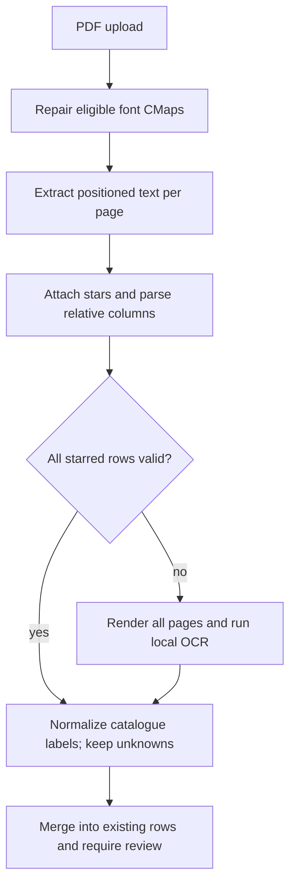

## Goal Capsule

Repair Ministry PDF imports locally in the browser, preserving students’ existing subjects. Authorized delivery is one branch and PR; no merge, production writes, settings changes, or review pipelines. All evidence uses invented transcript data. UI screenshot approval by Amit and Yonatan remains required before merge.

## Product Contract

### Summary and Problem Frame

Incorrect embedded ToUnicode maps corrupt digits and Hebrew. Number-only parsing confuses dates and component grades with final grades, ignores stars, and drops unknown names. Upload also replaces previously entered subjects.

### Requirements

- R1. Import only starred final subject rows, attaching offset markers with a baseline tolerance and selecting units and final grade by position. Ignore components, dates, hours, headers, and the all-star terminator. Retain unknown names.
- R2. Repair eligible embedded Identity-H TrueType fonts deterministically; OCR is local-only fallback when document-wide structural validation fails.
- R3. Merge imports by normalized subject label, preferring PDF scores while retaining existing subjects absent from the PDF. Preserve review confirmation and add only the requested short Hebrew count line.
- R4. Use synthetic fixtures, a count-only env-gated private test, ignore private files, and reject tracked PDFs outside the two approved directories.
- R5. Keep PDF dependencies lazy and pass lint, typecheck, focused tests, pre-PR guard, build, and browser verification where available.

### Scope Boundaries

No StudyJourney, calculators, evaluator, DB, migrations, analytics, environment, hosting settings, unrelated controls, new UI libraries, paid services, real transcripts, or review pipelines. No new OCR service or static fallback.

## Planning Contract

### Key Technical Decisions

- KTD1. Repair FontFile2 cmap format 4/12 into ToUnicode via dynamically imported pdf-lib (session-settled: user-directed — chosen over OCR-first: deterministic mapping is available). Skip unsupported or malformed fonts without throwing.
- KTD2. Parse positioned items with relative column relationships anchored by starred rows and units labels. Validate all starred rows across all pages before choosing text or whole-document OCR (session-settled: user-directed — chosen over per-page zero-row fallback: partial wrong extraction previously suppressed fallback).
- KTD3. Exercise the same repair/extraction/parser pipeline with Node legacy pdf.js and browser pdf.js. Test fontkit is generator-only and fully embedded Noto Sans Hebrew is fixture-only.

### High-Level Technical Design

## Implementation Units

### U1. Regression evidence and privacy perimeter

**Goal:** Prove failures before implementation and protect fixture handling. **Requirements:** R1–R4. **Dependencies:** none.

**Files:** parser and private tests under `src/lib/bagrutPdf*`, `src/components/JourneyExactGrades.test.tsx`, fixture directory, generator script, package files, `.gitignore`, PDF guard helper/test, `scripts/pre-pr-guard.mjs`.

**Approach:** Add positioned parser cases, full corrupted synthetic PDF pipeline, upload merge regressions, and tracked-PDF enforcement. Obtain Noto Sans Hebrew and its OFL from its official source. Use invented identity and scores only.

**Execution note:** Observe parser/pipeline and merge regression failures against current production code before implementing fixes.

**Test scenarios:** Zero-padded scores including 4/5, final versus component columns, month ambiguity, offset stars, terminator, hours, non-starred units rows, multiple pages, unknown names, normalized duplicate labels, retained manual math, and count-only private comparison. Raw extraction must prove deliberate glyph corruption.

**Verification:** Expected failures are recorded, fixture remains synthetic, and PDF allowlist tests cover tracked index paths.

### U2. Font repair and final-row pipeline

**Goal:** Correct complete extraction without OCR for valid text PDFs. **Requirements:** R1, R2, R4, R5. **Dependencies:** U1. **Files:** `src/lib/bagrutPdf.ts`, `src/lib/bagrutPdfFontRepair.ts` and their tests.

**Approach:** Implement KTD1–KTD3, document-wide sanity gating, OCR cleanup, and normalized catalogue mapping. Unsupported PDF/font structures remain unchanged. Keep limits and resource cleanup.

**Test scenarios:** U1 parser/fixture cases pass; format 4/12 and malformed font structures; invalid or missing starred units/grade trigger OCR for all pages; valid text avoids OCR.

**Verification:** Full synthetic pipeline returns exact invented subjects; fallback gating and cleanup tested.

### U3. Merge and concise import status

**Goal:** Preserve manual subjects and make unknown imports reviewable. **Requirements:** R3. **Dependencies:** U2. **Files:** `src/components/JourneyExactGrades.tsx` and existing tests; small normalization helper if required.

**Approach:** Functional row update using normalized labels; PDF values win, blank placeholders drop, unknown raw names remain. One right-aligned status line; preserve all other controls.

**Test scenarios:** Manual math survives an English-only PDF; normalized overlaps update once; unknown names and counts render; re-upload requires review again; failed upload preserves rows.

**Verification:** Existing and added component tests pass; real route desktop/mobile browser behavior checked where available.

### U4. Simplification, verification, delivery

**Goal:** Deliver a concrete verified PR. **Requirements:** R4, R5. **Dependencies:** U3. **Files:** only preceding units and this plan.

**Approach:** Apply ce-simplify-code with regression tests preserved, then Vercel verification skill. Inspect built route chunks for lazy pdf-lib and absent fontkit. Record check summaries and UI approval outstanding in PR.

**Test scenarios:** Run all touched/new tests and required checks; browser upload uses synthetic PDF only.

**Verification:** Lint, typecheck, focused Vitest, pre-PR guard, build pass. Push with hooks, open requested PR, report exact failures if publishing fails.

## Verification Contract and Definition of Done

Required commands: `npm run lint`, `npm run typecheck`, focused `npx vitest run` for Bagrut PDF, JourneyExactGrades and PDF guard tests, `npm run guard:pre-pr`, `npm run build`. Capture bundle evidence from generated chunks/manifests. Never assert private row objects or print private parsing exceptions. Private test skips when its environment variable is absent and always in CI. PR records missing real-file validation and any browser/preview limitations honestly. Delivery ends at an open PR; visual approval is required before merge.
