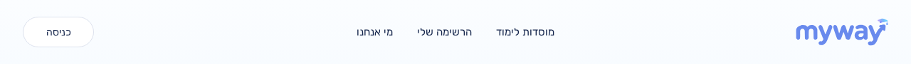
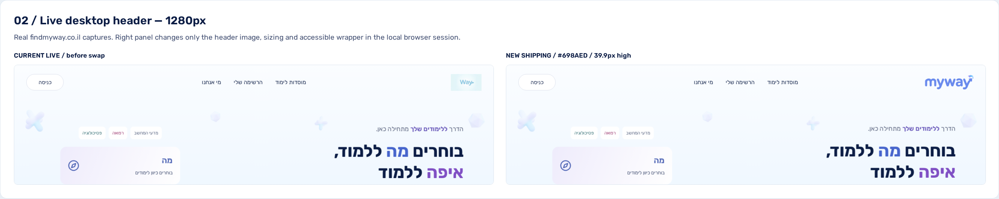
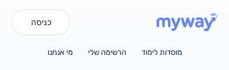
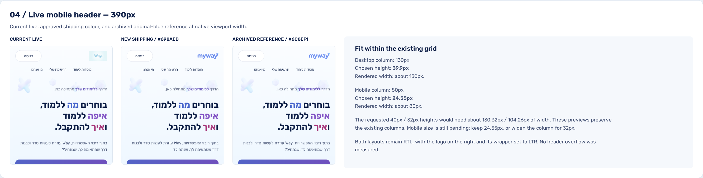
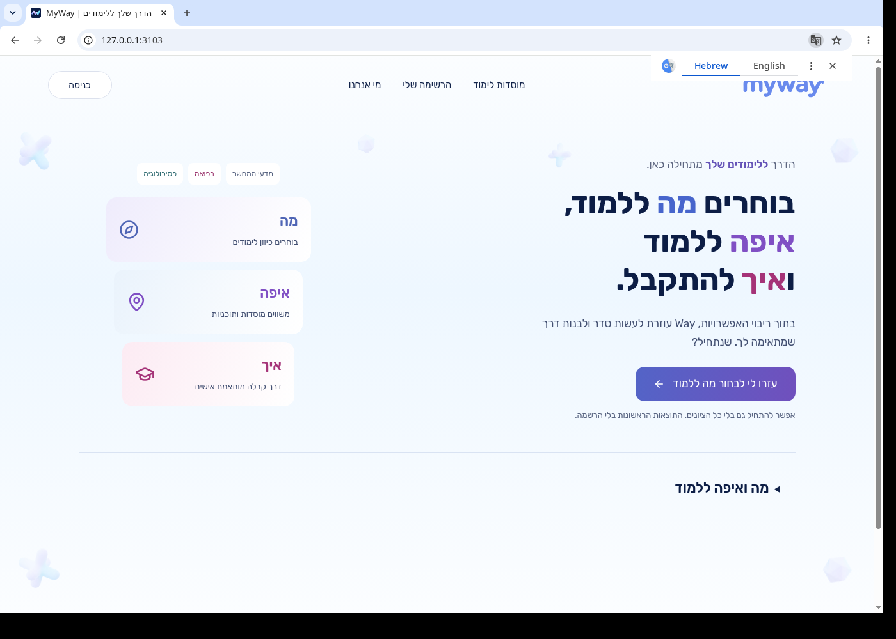

# Logo v2 verification

Visual change: Amit's screenshot approval is required before merge.

The ten assets in the main “Files Oded ships” table were copied byte for byte from `/workspace/design/brand/logo/v2-2026-10-24/wordmark/` and `favicon/`. No optional shipping assets were added. No footer files were changed.

| Viewport | Production-build header | Dana's preview section |
| --- | --- | --- |
| 1280px |  |  |
| 390px |  |  |

[Original Dana preview board](dana-preview.png) is an unchanged copy of `logo-v2-preview-2026-10-24.png`. The section images are unchanged copies of its supplied `preview/board-desktop.png` and `preview/board-mobile.png`. Their older mobile/open-item annotations are superseded by the closed decisions in the README and task brief.

The tab proof was captured from headed Chromium on Xvfb, visiting the local production build at `http://127.0.0.1:3103/`. Chromium requested `/favicon.ico?f6ab2bfd2a6ccfd2`. The header captures use headless Chromium at actual 1280px and 390px viewports, after the signed-out account action appears. All captures use the explicit local static catalogue mode; no deployed database behavior is claimed.

Desktop sizing discrepancy: main at `8b731e5` renders its legacy PNG at **82 × 44.671875px** ([baseline](main-header-1280.png)). The approved shipping README specifies a **130px column / 39.9px-high wordmark**. This implementation follows that approved size, rather than claiming the old and new image boxes are identical. The desktop grid stays `130px minmax(0, 1fr) 130px`; all other navigation styles stay unchanged. The only mobile grid change is **80px → 105px**, with a **32px-high** wordmark. Playwright verifies the approved desktop size and the 30–34px mobile range.

Verification:

- 108 focused Vitest tests passed across header, shared wordmark, assets, SEO, landing and authentication components. The new assertions were run failing before their implementation.
- Three Playwright checks passed against both the local development server and production build: 390px header; 1280px header; manifest/icon responses, icon declarations and Organization logo URL.
- `CATALOGUE_SOURCE_MODE=static npm run build`, `npm run typecheck`, targeted ESLint, and `npm run guard:pre-pr` passed.
- All ten destination files were compared byte for byte with the source shipping table. PNG dimensions, manifest contents and ICO 16/32/48px frames are covered by tests.
- Browser metadata contains exactly the Next app icon declarations plus the manifest link, without extra manual icon declarations.

Code review: skipped (ce-code-review unavailable) — Encoded profile restriction.
